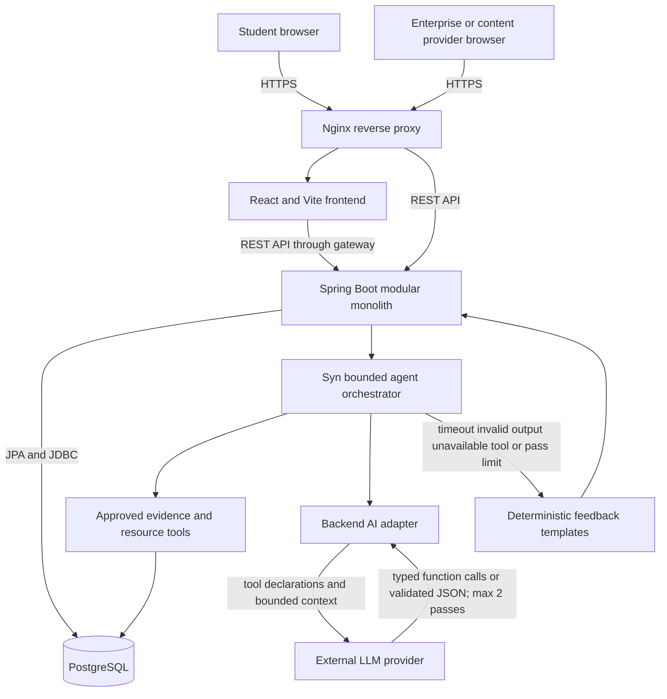

# System architecture

The MVP is a modular monolith deployed as separate frontend, backend, database, and reverse-proxy containers. The external LLM is an optional provider behind a backend-owned interface. PostgreSQL remains the only source of application data, and the LLM never receives direct database access.

## Backend modules

| Module | Responsibility | Current state |
|---|---|---|
| `identity` | Authentication, roles, profiles, consent | Account/consent read boundary exists; runtime login remains pending |
| `assessment` | RIASEC questionnaire and deterministic scoring | Preliminary US-01 backend implemented |
| `catalog` | Published simulation discovery | Working foundation slice |
| `simulation` | Tasks, attempts, submissions, deterministic evaluation | Preliminary US-02 backend implemented |
| `guidance` | Dashboard summaries, bounded session memory, typed read tools, bounded LLM tool calling, schema validation, and deterministic Standard fallback | US-03 bounded agent and global Syn widget implemented; runtime login remains pending |
| `enterprise` | Simulation authoring, publishing, and monitoring | Boundary reserved |
| `common` | Narrow cross-cutting API/configuration/error primitives | Working foundation |
| `system` | Health and operational endpoints | Working foundation |

Each module exposes a service interface as its application facade. Controllers depend on that interface, while implementation classes hide DAOs, entities, mappers, integrations, and transaction boundaries.

## Syn agent boundary

Syn is an orchestrated single-agent workflow, not an unrestricted autonomous agent.
For an eligible consented Gemini request, `SynAgentOrchestrator` permits exactly one
tool-selection pass and one final synthesis pass. Gemini may select only declared
`SynToolIdentifier` values with no arguments; `SynAgentToolbox` performs the
authenticated, read-only work and returns bounded observations. The synthesis pass
disables further function calls and validates the existing JSON reply schema.

`SynAgentPolicy` still computes the deterministic intent and static tool plan before
the provider exchange. It is the complete safety path when AI is disabled or Gemini
times out, rejects a request, returns malformed output, requests an unavailable tool,
or attempts a third step. Therefore Gemini cannot choose SQL, call an arbitrary URL,
change evidence, or persist a plan. Explicit plan confirmation remains a separate
service use case.

The policy also resolves `AUTO`/English/Vietnamese language, common Vietnamese
shorthand, exploration stage, and a bounded response depth. With no personal
evidence, the toolbox supplies reviewed catalog/path knowledge for honest onboarding
instead of pretending to personalize. Session memory stores compact codes rather
than raw dialogue. The frontend progressively reveals only the already validated
reply, anchors the submitted question, and leaves scrolling under student control;
this is deliberately not unvalidated provider-token streaming.

## Deployment correspondence

The root `docker-compose.yml` implements the architecture as four local services:

1. `gateway` routes browser traffic.
2. `frontend` serves the React build.
3. `backend` executes business rules and integrations.
4. `postgres` stores durable application data in a named volume.

The source architecture image is retained in `.agent/references/system-architecture.png`. This Mermaid diagram must be updated when the deployed topology changes.

## P1/P2 Syn core and vector RAG increment

PostgreSQL now requires pgvector. V10 adds versioned turn/session lifecycle, V11 adds published knowledge document/version/chunk tables and `vector(768)`, V12 adds sanitized trace metadata. Business evidence remains relational and authoritative. No frontend-to-provider, model-to-SQL or model-to-plan-write path was added.

The production message flow uses short snapshot/begin/finalization transactions around an external-call phase, not one long transaction. The seventh read tool, SEARCH_KNOWLEDGE, combines exact vector retrieval and local full-text search. Publication is an internal reviewed workflow, independent of chat. Deadline/cancellation and shared schema validation protect the generation boundary. Runtime authentication remains a separate dependency; localhost demo is not a production identity mechanism.

[Complete Vietnamese component map, sequence, fallbacks and Q&A](syn-core-rag-implementation.vi.md).
# Syn A/B/C continuation

See [implementation and limits in Vietnamese](syn-coach-abc.vi.md) and [manual test guide](../testing/syn-coach-manual.vi.md). This increment composes capabilities, improves resource fallback and memory, adds bounded Gemini retry and optional grounded web resources. RAG corpus publication still requires actual human content review.
