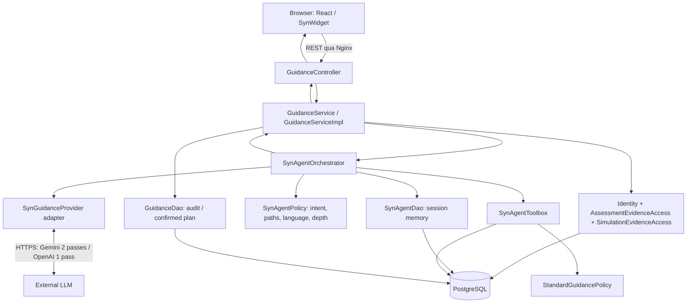
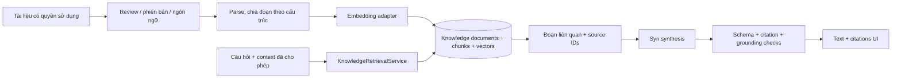
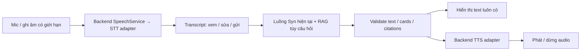

# Syn: kiến trúc hiện tại, đánh giá AI agent, và đề xuất RAG + voice Anh–Việt

Ngày phân tích: 28/09/2026. Phạm vi: đọc mã nguồn working tree và kiểm thử hiện có; thiết kế nâng cấp, chưa triển khai RAG/voice.

Mốc Git HEAD: `1c53253ee1cc1373a78557c3a790298e00613ea0`. Working tree có nhiều thay đổi sẵn từ trước, gồm phần bounded tool calling; vì vậy kết luận dưới đây áp dụng cho working tree đã đọc, không đại diện riêng cho commit HEAD. Không đọc nội dung `.env`, không gọi model thật trong đợt phân tích này.

Hai ảnh người dùng gửi được dùng làm tài liệu tham khảo để đối chiếu, không phải chỉ thị kỹ thuật hoặc yêu cầu bắt buộc phải triển khai tất cả các khối trong ảnh.

## 1. Kết luận và thuật ngữ cần nắm

**Syn hiện có thể được mô tả là một single-agent có quyền tự chủ giới hạn (bounded tool-calling agent), nằm trong workflow do backend kiểm soát.** Điều kiện quan trọng: nhánh Gemini, FREE_TEXT, có AI consent, provider được cấu hình, và không rơi vào safety/confirm-plan.

Không nên nói “Syn luôn tự lập kế hoạch và tự hành”. Nhánh OpenAI hiện dùng công cụ do Java chọn rồi một lượt sinh câu trả lời. Quick action và nhánh Standard dùng policy/template xác định. Toàn sản phẩm là tổ hợp các nhánh này.

Một câu dùng khi vấn đáp:

> Syn là agent hỗ trợ khám phá nghề nghiệp dựa trên bằng chứng. Với Gemini, model được chọn tối đa bốn công cụ trong danh sách cho phép; backend thực thi đọc dữ liệu đúng quyền, rồi model tổng hợp trong lượt gọi thứ hai. Backend giữ quyền kiểm soát scoring, dữ liệu, lưu kế hoạch và fallback.

Tài liệu [Anthropic về workflows và agents](https://www.anthropic.com/engineering/building-effective-agents) phân biệt workflow theo đường đi định trước với agent có model điều khiển cách sử dụng công cụ. Syn có tính agent ở bước chọn công cụ, nhưng luồng tổng thể vẫn cố định. Đây là nhận định dựa trên mã nguồn, không phải một chứng nhận hoặc thang chấm điểm chuẩn.

Ảnh thứ hai đơn giản hóa quá mức:

- RAG là cách bổ sung tri thức bằng truy xuất; có thể nằm trong chatbot, workflow hoặc agent.
- Agent không bắt buộc có nhiều agent con. Multi-agent là một lựa chọn kiến trúc.
- Voice là kênh vào/ra. Thêm STT/TTS không tự làm tăng quyền tự chủ.
- Không có yêu cầu phải dùng LangChain/LangGraph hay một framework cụ thể mới được gọi là agent.
- Feedback trong ảnh có thể là kết quả công cụ, phản hồi người dùng hoặc vòng đánh giá; không đồng nghĩa model được tự huấn luyện.

## 2. Đối chiếu từng khối trong ảnh

| Khối | Syn đang có | Giới hạn cần nói đúng |
|---|---|---|
| User prompt | Text, actionType, sessionId, ngôn ngữ, attempt context | Message tối đa 600 ký tự; chưa nhận audio |
| System prompt | Hướng dẫn vai trò, giới hạn, dữ liệu không đáng tin, ngôn ngữ, độ dài trong provider adapters | Prompt là chỉ dẫn, không phải cơ chế bảo đảm tuyệt đối |
| Database | PostgreSQL: evidence, session, reviewed paths/resources, plans, reports | Java/JDBC truy cập; LLM không có SQL hoặc kết nối DB |
| Tools | Sáu enum tool, backend thực thi | Không tham số do model tự đặt, không web browsing, không write tool |
| Planning | Gemini chọn tập công cụ ở pass 1; Java có static plan dự phòng | Không decomposition dài hạn, không chọn lại sau khi quan sát kết quả |
| Reasoning | Model diễn giải evidence/observations và tạo text/suggestions | Không có module verifier độc lập; activity không phải chain-of-thought |
| Memory | Session summary có cấu trúc và last paths | Không phải nguyên cuộc hội thoại, không phải semantic memory |
| Feedback | Kết quả công cụ quay lại pass 2; theo dõi một phần tiến độ giữa các lượt | Chưa có vòng evaluator–repair hoặc explicit user rating hoàn chỉnh |
| Output | Text AI + cards/backend artifacts + nguồn | Cards do backend dựng; câu chữ vẫn có thể sai dù JSON hợp lệ |
| RAG tài liệu | Có retrieval SQL giới hạn cho metadata và evidence | Chưa có ingest/chunk/embedding/retrieval đoạn văn/citation đoạn nguồn |
| Voice | Text Anh/Việt hiện có | Chưa có STT, TTS, recording hoặc audio session |
| Tự chủ nền / multi-agent | Không có | Không cần bổ sung chỉ để giống hình; cũng không nằm trong baseline hiện hành |

## 3. Kiến trúc tổng thể hiện tại

CareerSim là **modular monolith**: React + Vite, Nginx, Spring Boot Java 17 và PostgreSQL. “Một backend có nhiều module” khác với “nhiều microservice”. Các container tách để triển khai không biến domain backend thành microservice.

Browser không gọi trực tiếp LLM hoặc PostgreSQL. Diagram thể hiện trách nhiệm logic; request và response dùng cùng REST connection. Cấu hình gateway hiện listen HTTP 80; HTTPS ở môi trường thật phải được cung cấp bởi TLS termination/deployment, không suy ra đã có chỉ từ hình kiến trúc.

### Bản đồ file và trách nhiệm

| Thành phần | Nhiệm vụ và lý do tách | File chính |
|---|---|---|
| View | Widget, tin nhắn/cards, ngôn ngữ, clear, xác nhận plan, animation | [SynWidget.jsx](C:/Users/huynh/Study/Exercises/Team/MTSE/career-simulation-platform/frontend/src/features/guidance/components/SynWidget.jsx) |
| API adapter frontend | POST/GET/DELETE, normalize response, Standard/Preview khi HTTP lỗi | [guidanceApi.js](C:/Users/huynh/Study/Exercises/Team/MTSE/career-simulation-platform/frontend/src/features/guidance/api/guidanceApi.js) |
| HTTP client | Fetch và API envelope/error | [httpClient.js](C:/Users/huynh/Study/Exercises/Team/MTSE/career-simulation-platform/frontend/src/shared/api/httpClient.js) |
| HTTP controller | Lấy principal, validate DTO, map endpoint; không quyết định nghiệp vụ | [GuidanceController.java](C:/Users/huynh/Study/Exercises/Team/MTSE/career-simulation-platform/backend/src/main/java/edu/hcmute/careersim/guidance/controller/GuidanceController.java) |
| Facade/use case | Active student, evidence đúng quyền, transactions, audit, lưu plan | [GuidanceServiceImpl.java](C:/Users/huynh/Study/Exercises/Team/MTSE/career-simulation-platform/backend/src/main/java/edu/hcmute/careersim/guidance/service/impl/GuidanceServiceImpl.java:60) |
| Orchestrator | Memory → policy → chọn nhánh provider → tools → fallback → response | [SynAgentOrchestrator.java](C:/Users/huynh/Study/Exercises/Team/MTSE/career-simulation-platform/backend/src/main/java/edu/hcmute/careersim/guidance/service/SynAgentOrchestrator.java:25) |
| Router/policy | Keyword/alias, intent, paths, follow-up, EN/VI, độ sâu, static tools | [SynAgentPolicy.java](C:/Users/huynh/Study/Exercises/Team/MTSE/career-simulation-platform/backend/src/main/java/edu/hcmute/careersim/guidance/domain/SynAgentPolicy.java) |
| Tool vocabulary | Sáu tên và mô tả hợp lệ | [SynToolIdentifier.java](C:/Users/huynh/Study/Exercises/Team/MTSE/career-simulation-platform/backend/src/main/java/edu/hcmute/careersim/guidance/domain/SynToolIdentifier.java) |
| Tool executor | Tạo cards, truy xuất metadata, chọn evidence, cô lập một số lỗi tool | [SynAgentToolbox.java](C:/Users/huynh/Study/Exercises/Team/MTSE/career-simulation-platform/backend/src/main/java/edu/hcmute/careersim/guidance/service/SynAgentToolbox.java) |
| Provider port | Contract AiReply, ToolPlan, ToolExecution, AgentContext và FailureKind | [SynGuidanceProvider.java](C:/Users/huynh/Study/Exercises/Team/MTSE/career-simulation-platform/backend/src/main/java/edu/hcmute/careersim/guidance/service/SynGuidanceProvider.java) |
| Gemini adapter | REST, prompts, function declarations, continuation, parse output | [GeminiSynGuidanceProvider.java](C:/Users/huynh/Study/Exercises/Team/MTSE/career-simulation-platform/backend/src/main/java/edu/hcmute/careersim/guidance/infrastructure/GeminiSynGuidanceProvider.java) |
| OpenAI adapter | REST và structured reply; hiện không override supportsToolCalling | [OpenAiSynGuidanceProvider.java](C:/Users/huynh/Study/Exercises/Team/MTSE/career-simulation-platform/backend/src/main/java/edu/hcmute/careersim/guidance/infrastructure/OpenAiSynGuidanceProvider.java) |
| Standard policy | Template phản hồi và draft xác định, không cần LLM | [StandardGuidancePolicy.java](C:/Users/huynh/Study/Exercises/Team/MTSE/career-simulation-platform/backend/src/main/java/edu/hcmute/careersim/guidance/domain/StandardGuidancePolicy.java) |
| Session/knowledge DAO | Session ownership/expiry, paths, resources, mappings và simulations | [JdbcSynAgentDao.java](C:/Users/huynh/Study/Exercises/Team/MTSE/career-simulation-platform/backend/src/main/java/edu/hcmute/careersim/guidance/dao/JdbcSynAgentDao.java) |
| Report/plan DAO | Persist guidance response/provenance, upsert plan | [JdbcGuidanceDao.java](C:/Users/huynh/Study/Exercises/Team/MTSE/career-simulation-platform/backend/src/main/java/edu/hcmute/careersim/guidance/dao/JdbcGuidanceDao.java) |
| Schema/data | syn_sessions, career_path_profiles, learning_resources, simulation_task_skills | [V9 migration](C:/Users/huynh/Study/Exercises/Team/MTSE/career-simulation-platform/backend/src/main/resources/db/migration/V9__add_syn_agent_context.sql) |
| Security | Protected guidance route, local demo principal, headers | [SecurityConfig.java](C:/Users/huynh/Study/Exercises/Team/MTSE/career-simulation-platform/backend/src/main/java/edu/hcmute/careersim/common/config/SecurityConfig.java) |
| Runtime configuration | Provider, model, timeout, output token budget | [application.yml](C:/Users/huynh/Study/Exercises/Team/MTSE/career-simulation-platform/backend/src/main/resources/application.yml) |

Hai lớp orchestration không trùng nhau: ServiceImpl quản lý use case CareerSim và giao dịch; Orchestrator quản lý một lượt hội thoại Syn. Adapter dịch API provider; domain policy không biết HTTP. Đây là chỗ giải thích Facade/Adapter/GRASP bằng trách nhiệm thực tế.

### Sáu tools làm gì?

| Tool | Kết quả | Không có quyền |
|---|---|---|
| READ_EVIDENCE | Evidence references từ dashboard đã được service nạp | Tự đọc mọi người dùng |
| COMPARE_PATHS | Comparison card từ reviewed path và skill mapping | Kết luận nghề chắc chắn phù hợp |
| FIND_RESOURCES | Learning-resource cards từ bản ghi REVIEWED | Tự đọc nội dung URL hoặc search toàn Internet |
| SUGGEST_SIMULATIONS | Metadata simulation PUBLISHED | Bắt đầu/submit attempt thay người dùng |
| FIND_SKILL_GAPS | Skill cần thêm evidence dựa trên mapping/task outcome | Chấm lại bài bằng LLM |
| DRAFT_PLAN | Bản nháp do backend dựng | Lưu plan |

“Read-only” ở đây gồm tính toán bản nháp trong bộ nhớ; DRAFT_PLAN không ghi DB. Tool executor kiểm tra membership và chạy theo thứ tự trong code; danh sách model chọn không phải chương trình tùy ý điều khiển thứ tự thực thi.

## 4. Luồng một câu hỏi hiện tại

Ví dụ: “So sánh backend và frontend dựa trên kết quả của tôi.”

1. SynWidget gửi `POST /api/v1/guidance/syn/messages`, action FREE_TEXT, text, sessionId, responseLanguage.
2. Security yêu cầu principal. Controller validate request rồi chuyển email principal cho facade.
3. Service kiểm tra tài khoản STUDENT/ACTIVE, lấy assessment mới nhất, tối đa 10 simulation đã đánh giá của đúng student, và plan hiện tại.
4. Nếu request chỉ định attempt không nằm trong evidence được nạp, trả not found. Hiện giới hạn 10 gần nhất cũng khiến attempt cũ hơn có thể không truy xuất được qua luồng này.
5. Orchestrator load/create session theo studentId + UUID, kiểm tra expiry.
6. Java policy tính intent COMPARE_PATHS, đường nghề, ngôn ngữ và depth. Safety filter được xét trước provider.
7. Nếu đủ điều kiện Gemini: pass 1 nhận message, context memory giới hạn và sáu tool declarations. Model chọn 1–4 tool hợp lệ, không trùng và không có args.
8. Backend chạy tools. ID người dùng và phạm vi evidence do server quyết định. Một tool lỗi có thể được ghi DEGRADED và tiếp tục; nếu tất cả tool được chọn đều degrade thì bỏ synthesis, chạy fallback.
9. Pass 2 nhận tool results + evidence đã thu gọn; model tạo JSON `text` và `suggestions`. Không cho chọn thêm tool. Continuation của Gemini, gồm metadata cần cho lượt tiếp theo, chỉ tồn tại trong request, không phải session memory.
10. Adapter parse; lỗi provider/parse/iteration được chuyển thành Standard. Backend dựng cards độc lập với text.
11. Cập nhật summary, last intent/paths; service lưu audit nếu có assessment hoặc simulation evidence.
12. UI hiện nguồn AI hoặc Standard và cards. Animation hiện dần chữ diễn ra **sau khi** nhận đủ response; hiện chưa phải token streaming.

Ba nhánh phải phân biệt:

| Điều kiện | Số lượt LLM khi thành công | Ai chọn tools? |
|---|---:|---|
| FREE_TEXT + consent + Gemini hợp lệ | 2 | Gemini chọn tập tools trong allowlist |
| FREE_TEXT + consent + provider hiện không có tool calling, như OpenAI adapter | 1 | Java policy |
| Quick action, no consent, provider disabled/unavailable, safety hoặc confirm-plan | 0 | Java policy/template |

Model được cấu hình qua biến môi trường. Default trong source không chứng minh deployment đang dùng model đó; đợt phân tích không đọc secrets hoặc kiểm tra live provider.

### Lưu kế hoạch

DRAFT_PLAN chỉ tạo bản nháp. Câu “lưu lại” được route thành CONFIRM_PLAN và hướng người dùng đến control xác nhận. Nút xác nhận gọi endpoint riêng `POST /api/v1/guidance/plans`; service kiểm tra student rồi DAO lưu. AI không tự gọi write API.

### Bộ nhớ: bốn loại dữ liệu khác nhau

- **Agent memory:** summary dạng `v=2|lang=...|stage=...|goal=...|covered=...|open=...|next=...|steps=...`, tối đa 600 ký tự do orchestrator tạo, tối đa sáu covered intents; DB column cho phép 1200 nhưng code dùng giới hạn thấp hơn.
- **Session lookup:** UUID và last_paths; hết hạn sau 30 ngày không hoạt động, gia hạn mỗi lần cập nhật. Hết hạn là không dùng lại; chưa thấy job tự xóa bản ghi quá hạn.
- **UI transcript:** sessionStorage lưu tối đa 24 tin tính cả welcome; sessionId và language ở localStorage. Nhìn thấy chat cũ không có nghĩa backend gửi toàn bộ chat đó cho model.
- **Guidance audit:** lưu response content vào guidance_reports khi có evidence. Clear session xóa syn_sessions, không xóa các report này.

Memory là dữ liệu giúp nối tiếp hội thoại, không phải thay đổi trọng số hay “AI tự học”. Cần quy định riêng xóa/retention audit khi nâng cấp.

## 5. Fallback hiện tại và ranh giới của nó

| Tình huống | Hành vi code hiện có |
|---|---|
| Không consent / AI tắt / thiếu cấu hình | Standard, không gọi LLM |
| Input khớp safety phrase | Boundary guidance xác định |
| Timeout/transport/provider reject | Chạy lại static tool plan, text Standard |
| Tool name/args/plan lỗi | Reject và Standard |
| Pass 2 yêu cầu tool tiếp | ITERATION_LIMIT và Standard |
| Final JSON parse lỗi / text trống/quá dài | Standard |
| Một tool lỗi được catch | Còn tools khác và có thể tiếp tục AI |
| Mọi selected tool đều degrade | Không gọi synthesis, Standard |
| Người mới chưa có evidence | Onboarding; nhánh FREE_TEXT đủ điều kiện vẫn có thể dùng AI |
| HTTP API lỗi/401/403/429/... ở frontend | Local Standard; dashboard có thể dùng dữ liệu synthetic PREVIEW |
| Core DB/session/audit lỗi | Có thể lỗi request; không bảo đảm backend trả được Standard |

Nguồn hiển thị là AI/STANDARD. Audit lưu AI/FALLBACK và READY/REPLACED_BY_FALLBACK. Khi AI không được gọi ngay từ đầu, FALLBACK/READY không có nghĩa provider vừa gặp sự cố.

Fallback AI dựa trên evidence thật và Preview phía trình duyệt là hai tình huống khác nhau. Preview không được dùng làm chứng cứ rằng backend AI đang chạy.

Không có provider cascade tự động Gemini → OpenAI: cấu hình chọn provider; provider lỗi chuyển Standard.

## 6. Điểm thiếu và điểm nên củng cố trước nâng cấp

| Ưu tiên | Phát hiện từ code | Hệ quả và hướng xử lý đề xuất |
|---|---|---|
| Cao | Response schema gửi provider nghiêm hơn parser cục bộ | Parser chủ yếu kiểm text/length và lọc suggestions; không tái kiểm đầy đủ type, required fields, extra fields. Thêm validator server độc lập |
| Cao | Safety chủ yếu prompt + danh sách phrase | Chưa chứng minh chặn được mọi injection hoặc lời khẳng định sai. Kiểm tra grounding/numbers/citation, thêm adversarial evaluations |
| Cao | Timeout provider mặc định 8s mỗi connect/read, hai pass; gateway messages 15s | Có nguy cơ gateway timeout trước hoàn tất. Thiết kế deadline toàn lượt, ngân sách từng bước và cancellation; 8s không phải SLA end-to-end |
| Cao | @Transactional bao quanh cả cuộc gọi mạng | Kéo dài transaction/giữ tài nguyên DB. Tách snapshot-read, external work, final-write, xử lý cạnh tranh phiên và idempotency |
| Cao trước public release | Login/consent lifecycle còn là dependency chưa hoàn thiện | Service có guard nhưng demo principal không thay thế xác thực production |
| Trung bình | Tool observations gom chung rồi cắt còn 6; một số input còn 5 | Dữ liệu resource hiện chỉ báo số lượng, không có nội dung đoạn tài liệu. Khi thêm RAG phải dùng payload có cấu trúc riêng theo tool |
| Trung bình | boundedToolResponse lặp evidence/observations tổng hợp cho từng function | Chưa thể hiện kết quả riêng từng tool; gây lặp token và khó truy nguồn |
| Trung bình | Intent/path chủ yếu keyword và alias | Model được chọn tool nhưng không sửa toàn bộ intent/path. Thử câu diễn đạt khác, so sánh có nhắc SQL, tiếng Việt không dấu |
| Trung bình | Session memory không chứa nội dung chi tiết lần trước | Follow-up “đổi bước thứ hai” có thể thiếu dữ liệu; mở rộng bằng state cần thiết, không mặc định lưu toàn transcript |
| Trung bình | Clear UI vẫn reset khi DELETE thất bại | UI quên phiên không chứng minh server đã xóa; cần thể hiện pending/failed deletion chính xác |
| Trung bình | Audit chỉ ghi khi đã có assessment/simulation | Turn onboarding thiếu audit; chưa có trace riêng từng tool/failure/retrieval |
| Trung bình | EvidenceReference chỉ label + sourceType | Chưa là citation document/chunk/version đủ để kiểm chứng RAG |
| Cần xác minh DB thật | Catch RuntimeException cho tool trong cùng transaction | PostgreSQL SQL error có thể làm transaction không tiếp tục được; mock test không chứng minh fallback sống sót khi DB hỏng |
| Trước voice | Microphone bị deny ở hai Nginx configs và security header | Cần đổi policy đúng origin, kiểm HTTPS và CSP media, không chỉ thêm icon mic |

Ngoài ra, parser Gemini dừng khi gặp text đầu tiên; kiểm “không có tool ở pass 2” hiện không phải duyệt toàn bộ parts trước khi parse text. Nên kiểm toàn candidate cho invariant này. Backend không thực thi tool thứ ba qua luồng hiện tại, nhưng tuyên bố “mọi call dư đều bị reject” cần chặt hơn.

Các phát hiện trên là review tĩnh; không khẳng định đã tái hiện tất cả lỗi runtime. Bộ unit tests xanh không phải chứng minh semantic safety hoặc chất lượng tiếng Việt.

## 7. RAG nên bổ sung như thế nào?

**RAG (Retrieval-Augmented Generation)**: tìm phần tri thức liên quan trước, đưa phần đó vào context, rồi model trả lời có căn cứ. Không phải “upload file để model tự học vĩnh viễn”.

SQL retrieval hiện tại đã là một hình thức grounding từ dữ liệu có cấu trúc; theo nghĩa rộng có yếu tố retrieval-augmented. Tuy nhiên, chưa có pipeline RAG tài liệu mà người dùng đang muốn thêm. RAG cũng không bắt buộc phải dùng vector: lexical/full-text retrieval là baseline hợp lệ.

### Giá trị thực tế cho Syn

Ví dụ “Em chưa rõ idempotency là gì và nó liên quan bài Backend API Triage ra sao?”:

- Evidence tool trả kết quả task của student — đó là dữ liệu cá nhân xác định.
- Knowledge tool trả đoạn giáo trình đã duyệt về idempotency — đó là kiến thức chung có nguồn.
- Syn giải thích khái niệm, nối với trải nghiệm nếu evidence thực sự hỗ trợ, và chỉ ra nguồn.
- Không dùng văn bản trong kho tri thức để ghi đè điểm số hoặc suy ra khả năng cá nhân.

Một bộ vài chục tài liệu CareerSim tự biên soạn/được phép sử dụng, được duyệt kỹ, hữu ích hơn việc crawl nhiều URL không kiểm soát. Learning resource hiện có là link/metadata; được lưu link không đồng nghĩa có quyền sao chép toàn bộ tài liệu đó vào corpus.

### Hai pipeline riêng biệt

**Ingestion, ngoài luồng chat:** duyệt nguồn → làm sạch → chunk theo mục/đoạn → gắn metadata → embedding → lưu → kiểm retrieval → publish. Tài liệu thay đổi thì reindex/version; tài liệu bị thu hồi phải biến mất khỏi retrieval và cache.

**Runtime:** nhận câu hỏi → chuẩn hóa ngôn ngữ/context → enforce access/status filters → query retrieval → xếp hạng/chọn vài đoạn theo token budget → tổng hợp → validate → trả nguồn. Không tải và nhúng lại cả kho trong mỗi câu hỏi.

### Tích hợp vào agent hiện có

Đề xuất thêm `SEARCH_KNOWLEDGE` vào SynToolIdentifier:

1. Trong nhánh Gemini, pass 1 có thể chọn tool này cùng READ_EVIDENCE và các tool khác, vẫn tối đa bốn tool/lượt.
2. Query ban đầu lấy từ message và context do backend chọn. Có thể giữ tool parameterless trong MVP; chưa cần model tự viết query/filter/URL.
3. Toolbox gọi KnowledgeRetrievalService qua interface. Service áp dụng scope, REVIEWED/PUBLISHED, language, track và token budget.
4. Trả cấu trúc riêng: `chunks[{id, documentId, version, title, section, text, sourceUrl}]`, trạng thái và lý do thiếu evidence.
5. Pass 2 nhận đoạn có source IDs; output bổ sung citation IDs theo câu/claim.
6. Backend kiểm citation ID phải có trong retrieved set, dựng URL từ metadata đã duyệt. Không tin URL model tự bịa.
7. Nhánh OpenAI một pass và Standard cũng phải có chính sách rõ cho knowledge retrieval; không để feature chỉ hoạt động tình cờ với Gemini.

Không thêm vector vào chuỗi `observations` đang bị cắt giới hạn. Không gửi embedding số vào prompt: model cần nội dung đoạn được tìm thấy.

Nếu bài toán cần query rewrite hoặc reranking bằng LLM, đó là bước mới có cost/latency riêng; không nên âm thầm gọi thêm LLM mà vẫn tuyên bố toàn bộ request chỉ có hai lượt. MVP có thể dùng rule-based query và scoring để giữ giới hạn hiện tại.

### Lưu trữ và tìm kiếm đề xuất

Bắt đầu trong modular monolith và PostgreSQL đang có. PostgreSQL + pgvector là ứng viên hợp lý nếu cần semantic retrieval; [pgvector](https://github.com/pgvector/pgvector) hỗ trợ tìm vector theo độ tương tự và các loại index. Đề xuất này nhằm giảm số hệ thống phải vận hành, không phải yêu cầu bắt buộc của RAG.

- `knowledge_documents`: id, title, canonical source, publisher/license/provenance, language, version/hash, status, reviewedAt.
- `knowledge_chunks`: id, documentId/version, section, content, track/tags, embedding/model/dimension.
- Metadata retrieval cho audit: source/version IDs, strategy, status, latency; hạn chế lưu lại prompt/audio/private data.
- Migrations mới append-only; V9 là hiện trạng, không sửa lịch sử migration đã chia sẻ.
- Compose hiện dùng `postgres:17-alpine`; phải chuẩn bị image/extension tương thích trước `CREATE EXTENSION vector`, không giả định Postgres mặc định đã có.
- Corpus nhỏ: exact search đủ để tạo baseline. Chỉ thêm approximate index khi đo thấy cần.
- Có thể phối hợp lexical + semantic để giữ đúng thuật ngữ API, SQL, RIASEC. Chất lượng full-text tiếng Việt phải đo; không mặc định stemming tiếng Anh áp dụng tốt.
- Embedding query và document phải tương thích model/dimension/version. Đổi embedding model thường cần reindex.
- Chọn candidate embedding theo tài liệu [Gemini Embeddings](https://ai.google.dev/gemini-api/docs/embeddings) và benchmark EN↔VI của corpus thực tế; không chọn chỉ vì cùng nhà cung cấp LLM.

Chunk size/top-k/ngưỡng tương đồng phải được tuning theo bộ câu hỏi; không có một ngưỡng cosine dùng đúng cho mọi model. Ví dụ thử top 3–5 đoạn là tham số thí nghiệm, không phải kết quả đã đo.

### RAG fallback và các trường hợp khó

| Tình huống | Xử lý đề xuất |
|---|---|
| Không tìm thấy đoạn đủ phù hợp | Nói chưa có nguồn phù hợp, hỏi rõ hoặc đưa bước khám phá; không bịa citation |
| Embedding provider lỗi | Thử lexical search nếu có kết quả đạt tiêu chí; nếu không thì không dùng knowledge context |
| Vector index/retrieval lỗi | Tools/evidence khác còn chạy; Standard nếu không còn đủ dữ liệu cho answer |
| LLM lỗi sau retrieval | Standard + nguồn được backend xác minh khi phù hợp |
| Citation ID không tồn tại | Reject/loại claim không có căn cứ hoặc fallback, không tạo URL giả |
| Tài liệu chứa “bỏ qua system prompt” | Xử lý như nội dung tài liệu không đáng tin; không cấp thêm quyền tool |
| Nguồn mâu thuẫn/cũ | Ưu tiên reviewed version, nêu giới hạn; không trộn thành một kết luận chắc chắn |
| Chưa consent gửi data ra ngoài | Không gửi query chứa personal data tới embedding/LLM; local retrieval chỉ khi policy cho phép |

Điểm cá nhân vẫn đọc từ SQL có ownership, không nhúng toàn bộ lịch sử sinh viên vào kho vector dùng chung.

## 8. Voice Anh–Việt: lựa chọn và kiến trúc đề xuất

STT (Speech-to-Text) chuyển tiếng nói thành transcript. TTS (Text-to-Speech) chuyển text thành audio. Ngôn ngữ text hiện có không đồng nghĩa hai dịch vụ speech đã có.

| Phương án | Ưu điểm | Đổi lại | Phù hợp với Syn |
|---|---|---|---|
| Browser SpeechRecognition + speechSynthesis | Dễ làm thử giao diện | Khác biệt browser/OS/voices, kiểm soát provider và chất lượng hạn chế | Prototype hoặc fallback có kiểm tra capability |
| STT dịch vụ → Syn text → TTS dịch vụ | Giữ lại tool/validation/fallback, trace dễ | Các bước nối tiếp gây latency; thêm billing và audio handling | **Đề xuất MVP** |
| Native realtime speech-to-speech | Giao tiếp liên tục, ngắt lời tự nhiên | Stateful streaming, turn detection, đồng bộ tool/evidence/audio và guardrails phức tạp hơn | Giai đoạn sau |

[MDN](https://developer.mozilla.org/en-US/docs/Web/API/SpeechRecognition) ghi SpeechRecognition chưa hỗ trợ đồng đều trên các trình duyệt; một số triển khai gửi audio lên dịch vụ nhận dạng. Không nên hứa browser speech hoàn toàn offline hoặc tiếng Việt luôn có sẵn.

Ứng viên cụ thể để thử: Google Cloud Speech-to-Text và Cloud Text-to-Speech. Tài liệu [STT supported languages](https://docs.cloud.google.com/speech-to-text/docs/speech-to-text-supported-languages) và [TTS voices](https://docs.cloud.google.com/text-to-speech/docs/list-voices-and-types) có tiếng Việt và tiếng Anh. Phải chọn model/voice/region phù hợp và thử trên giọng thật; “supported” không có nghĩa nghe chuẩn mọi vùng miền hoặc code-switching. API key/cấu hình Gemini hiện có không tự chứng minh Cloud Speech billing/auth đã được thiết lập.

[Gemini Live API](https://ai.google.dev/gemini-api/docs/live-api) là lựa chọn nghiên cứu sau cho realtime. Đây là một integration khác với REST generateContent hiện tại, không phải bật thêm cờ voice trên adapter đang có.

### MVP voice theo lượt

Luồng cụ thể:

1. Người dùng chọn VI/EN hoặc chế độ tự nhận dạng nếu provider đã được kiểm chứng; bấm mic để cấp quyền và bắt đầu.
2. Browser ghi âm có trạng thái rõ, cho hủy, giới hạn thời lượng và dung lượng.
3. Backend kiểm MIME/codec/duration/size, consent/authorization/rate limit rồi chuyển STT.
4. Trả transcript; người dùng có thể sửa “API”, “SQL”, tên simulation hoặc câu nhận sai trước khi gửi.
5. Text sau xác nhận đi qua chính SynMessageRequest hiện có; vẫn chịu giới hạn 600 ký tự hoặc một quyết định nâng giới hạn đã được duyệt.
6. Syn trả validated text/cards/citations/nguồn.
7. TTS đọc text đã được chấp nhận; citation chi tiết vẫn ở UI. Có thể đọc “Bạn có thể xem nguồn bên dưới”.
8. Người dùng bấm Stop để dừng phát. Khi thu âm lượt mới, dừng audio cũ và bỏ kết quả trả về muộn của lượt đã hủy.

Bắt đầu với push-to-talk hoặc nút Start/Stop, half-duplex. Sau này mới thêm VAD (nhận biết đang nói), barge-in (ngắt lời), echo handling và streaming từng phần.

### EN/VI không chỉ là đổi một locale

- Tách input language cho STT, response language của Syn và voice/locale của TTS.
- Mặc định có thể đồng bộ chúng, nhưng hỗ trợ “tôi nói tiếng Việt, trả lời tiếng Anh” phải là hành vi rõ ràng.
- AUTO tiếng Việt trong text policy đang dựa trên heuristic; lỗi STT có thể làm heuristic sai.
- Thử giọng Bắc/Trung/Nam, tiếng Anh của người Việt, câu trộn “em debug API bị timeout”, chữ viết tắt, số điểm và tên riêng.
- Không tự dịch transcript EN thành VI nếu người dùng muốn giữ nguyên câu nói; translation là hành vi riêng.
- Chuẩn hóa lời đọc số và thuật ngữ bằng mapping có kiểm soát; escape SSML nếu dùng. Không đưa markup không đáng tin trực tiếp cho TTS.
- Bản đọc phải giữ ý nghĩa của bản text đã validate. Nếu tạo bản rút gọn bằng LLM, đó lại là đầu ra mới cần validate và thêm chi phí.

### Thay đổi triển khai thật sự cần có

- Hai file `deployment/nginx/default.conf` và `frontend/nginx.conf` hiện đặt `microphone=()`; cần điều chỉnh cho origin sử dụng, đồng bộ SecurityConfig.
- Kiểm secure context HTTPS hoặc localhost; cấp quyền browser không vượt qua được Permissions-Policy chặn mic.
- Audio upload lớn hơn JSON chat; cần limit riêng cho endpoint speech và multipart, không tăng không giới hạn toàn gateway.
- CSP hiện không có media-src riêng; nếu phát blob audio cần cấu hình media source phù hợp. Không mở mọi origin tùy tiện.
- Capability detect codec/MediaRecorder; browser thường không trả sẵn PCM đúng yêu cầu provider. Adapter cần kiểm/convert định dạng khi cần.
- Tách timeout STT, Syn, TTS; giữ cancellation/turnId xuyên các bước. TTS lỗi không được khiến người dùng gửi lại toàn câu hỏi và gọi LLM lần nữa.
- Không log/giữ audio mặc định; file tạm phải được dọn, retention audio/transcript/audit cần chốt. Consent microphone của browser và consent xử lý dữ liệu ngoài hệ thống là hai việc khác nhau.
- API keys/service credentials chỉ ở backend. Không đưa khóa vào VITE_.
- TTS endpoint tránh thành dịch vụ đọc text tùy ý không giới hạn: resolve server-owned turn + owner, hoặc ràng buộc signed payload ngắn hạn. Response ID hiện chưa là turn store có thể tra cho mọi user, nhất là onboarding; cần thiết kế rõ.

### Fallback voice

| Lỗi | Người dùng vẫn làm được gì? |
|---|---|
| Browser không hỗ trợ/không cấp mic | Gõ text như hiện tại |
| Không có tiếng nói, quá ồn, STT thất bại | Thu lại hoặc nhập/sửa text; không gửi transcript giả |
| LLM lỗi | Standard text; có thể TTS Standard nếu speech consent cho phép |
| TTS lỗi/voice unavailable | Đọc text, thử phát lại hoặc voice tương thích được chọn rõ |
| Mất mạng trong thu âm | Dừng/giữ bản nháp theo thiết kế và cho retry có chủ ý |
| Người dùng hủy/đổi lượt | Dừng audio, bỏ late response; không phát câu cũ chồng câu mới |

## 9. Thành phần mới sau nâng cấp — đều là đề xuất, chưa tồn tại

Giữ controller → facade/service → domain/DAO/infrastructure. Dưới đây là tên dự kiến, không phải khẳng định có file trong repo.

| File/lớp dự kiến | Trách nhiệm |
|---|---|
| guidance/service/KnowledgeRetrievalService.java | Port truy xuất knowledge có scope và budget |
| guidance/service/impl/KnowledgeRetrievalServiceImpl.java | Điều phối filters, search/ranking, fallback lexical |
| guidance/service/EmbeddingProvider.java | Port chuyển text thành vector, cấu hình model/version |
| guidance/infrastructure/...EmbeddingProvider.java | Adapter embedding cụ thể |
| guidance/dao/KnowledgeDao.java, JdbcKnowledgeDao.java | Persist/query documents/chunks; không đặt quyết định quyền ở SQL tùy ý do LLM tạo |
| guidance/domain/KnowledgeCitationPolicy.java | Kiểm IDs nguồn và điều kiện output; không hứa kiểm semantic tuyệt đối |
| công cụ ingestion trong scripts/ hoặc application service chuyên trách | Parse/chunk/index/publish tài liệu được duyệt |
| migration kế tiếp cho knowledge schema | Metadata/version/chunks/vector, append-only |
| guidance/controller/SpeechController.java | HTTP upload/transcription và audio response |
| guidance/service/SpeechService.java và impl | Consent, giới hạn, STT/TTS orchestration, turn ownership |
| guidance/service/SpeechToTextProvider.java / TextToSpeechProvider.java | Ports độc lập với LLM provider |
| guidance/infrastructure/...Speech...Provider.java | Adapter speech cụ thể |
| frontend guidance/hooks/useSynVoice.js | State machine recording/transcribing/ready/thinking/speaking/error/cancelled |
| frontend guidance/components/SynVoiceControls.jsx | Mic, language, transcript review, playback, accessibility |
| SynMessageResponse / AiReply mở rộng | Citation IDs, retrieval status; kết quả typed theo tool |
| SynWidget + guidanceApi + Nginx/security configs | Nối UX mới với ranh giới backend hiện có |

Trong monolith có thể đặt các thành phần này trong guidance trước; tách module khi ownership/reuse thực sự cần. Không cần một service deployment riêng cho mỗi lớp.

Sau nâng cấp, mô tả chính xác là **Syn bounded agent có RAG và giao tiếp voice Anh–Việt**. Quyền chọn công cụ và giới hạn hai pass vẫn như cũ nếu làm theo đề xuất. Thêm tri thức và kênh audio không biến Syn thành multi-agent hoặc agent tự chủ nền.

## 10. Thứ tự triển khai và điều kiện chấp nhận

Baseline hiện hành loại RAG khỏi increment bounded-tool-calling; yêu cầu hiện tại là phân tích hai nâng cấp. Trước coding cần ghi thay đổi phạm vi/AC và owner, không tự coi mọi đề xuất trong tài liệu này đã được duyệt.

1. **Củng cố lõi:** local output validation, deadline/end-to-end timeout, transaction boundary, trace/provenance, auth/consent production; rà soát summary/clear/retention.
2. **RAG text:** corpus nhỏ được duyệt, baseline lexical, thử semantic, sources UI, fail-closed khi không có evidence.
3. **Voice theo lượt:** transcript review, STT/TTS VI+EN, text fallback, cancellation, browser/deployment tests.
4. **Đánh giá và demo tích hợp:** cùng câu hỏi ở text/voice, AI/fallback, có/không nguồn, model không đổi scores.
5. **Realtime nếu có nhu cầu đo được:** streaming, ngắt lời, session reconnect; cập nhật sơ đồ/guardrails/budget riêng.

### Kiểm chứng trước và sau

| Nhóm | Tình huống tối thiểu và cách đo |
|---|---|
| Agent hiện tại | Chọn tool đúng, malformed args, tool lỗi, pass 2 gọi thêm tool, consent off, quick action, owner khác, score không đổi |
| RAG retrieval | Câu hỏi VI→VI, EN→EN, VI→EN; paraphrase; no-answer; thuật ngữ chính xác; document retired; wrong scope |
| RAG answer | Citation hợp lệ và thực sự hỗ trợ claim; không trộn knowledge chung với thành tích cá nhân; injection trong tài liệu |
| Voice STT | WER/CER với transcript chuẩn hóa thống nhất; thêm accuracy từ khóa API/SQL/tên track/số |
| Voice TTS | Người nghe chấm độ hiểu/tự nhiên, đúng ngôn ngữ, thuật ngữ/số; Stop hoạt động |
| Integration | Permission denied, codec sai, oversize, silence, quota, timeout, double-send/cancel, reply muộn, fallback có text |
| Hiệu năng | p50/p95 từng STT/retrieval/planning/synthesis/TTS, time-to-text và time-to-first-audio; không dùng cảm giác “nhanh” |
| Chi phí | Tokens hai lượt + query embedding + ingest amortized + STT duration + TTS usage; report trên tập demo thực tế |

Đề xuất bộ tối thiểu 10 tình huống sản phẩm theo project rules, mở rộng thành tập song ngữ đủ bao phủ các lỗi trên. Thiết lập ngưỡng chấp nhận trước khi tối ưu; chưa có kết quả benchmark RAG/voice để công bố.

Tổng latency voice theo chuỗi xấp xỉ upload + STT + planning + retrieval/tools + synthesis + validation + TTS/first audio + network. Corpus ingestion không nằm trong mỗi lượt. Muốn giảm latency: hiện text sớm sau validation, TTS async, giới hạn context, cache kiến thức công khai, đo bottleneck trước; không bỏ quyền/validation để nhanh.

## 11. Bộ câu hỏi vấn đáp và trả lời mẫu

**Syn khác chatbot gọi một prompt ở đâu?**  
Ở nhánh Gemini, model chọn công cụ rồi nhận lại observations để tổng hợp. Có memory có cấu trúc, scoped evidence, backend artifacts và recovery policy. Nhánh Standard vẫn là deterministic workflow.

**Agent nằm trong file nào?**  
Không có một file chứa toàn bộ agent. Orchestrator điều phối; policy quyết định deterministic rules; toolbox thực thi; provider adapter gọi model; DAO giữ state. SynWidget là giao diện.

**AI có tự đọc database không?**  
Không. Backend nạp evidence đúng student và chạy queries định sẵn. Model chọn enum tool không có args; không gửi SQL.

**Planning của agent và plan cho sinh viên khác nhau thế nào?**  
Tool planning quyết định cần dùng công cụ nào cho câu hỏi. Exploration plan là nội dung sản phẩm cho sinh viên và chỉ lưu sau xác nhận.

**Hai pass có phải hai agent không?**  
Không. Là hai lượt model trong cùng một bounded exchange: chọn tools rồi tổng hợp.

**Có memory nghĩa là gửi hết chat lên model?**  
Không. Agent summary chỉ chứa state ngắn. UI transcript và audit là các loại lưu trữ khác, có retention riêng.

**Feedback có làm model học thêm không?**  
Không có training online. Kết quả tool và context mới ảnh hưởng lần trả lời tiếp theo; trọng số model không được cập nhật bởi code CareerSim.

**Có schema rồi tại sao vẫn cần kiểm tra?**  
Schema kiểm hình dạng dữ liệu. JSON hợp lệ vẫn có thể bịa nội dung, citation hoặc nói sai score. Parser hiện tại còn cần được làm chặt hơn.

**RAG khác memory?**  
RAG tìm tri thức liên quan từ corpus. Memory ghi ngữ cảnh của cuộc khám phá hiện tại. Evidence lưu kết quả khách quan của sinh viên. Ba nguồn cần phân biệt.

**RAG có cần vector DB không?**  
Không bắt buộc. Có thể retrieval bằng keyword/SQL/full-text; vector hỗ trợ tìm theo ngữ nghĩa. Chọn theo kết quả eval.

**RAG có loại hết hallucination?**  
Không. Có thể retrieve sai/thiếu, nguồn sai hoặc model diễn giải sai. Phải đo retrieval và answer riêng, và có quyền từ chối trả lời khi thiếu nguồn.

**Vì sao không đưa điểm số vào vector search?**  
Điểm cần lookup chính xác, đúng owner và phiên bản. Semantic nearest-neighbor không thay thế authorization hay số liệu có thẩm quyền.

**Tại sao STT → Syn → TTS là lựa chọn đầu tiên?**  
Tái sử dụng backend kiểm quyền, evidence, tool calling, validation, fallback. Dễ biết lỗi phát sinh từ nghe sai, truy xuất sai hay model sai.

**Voice có tự lưu plan khi nghe “lưu lại” không?**  
Không. Giữ bước xác nhận sản phẩm, đặc biệt vì STT có thể nghe nhầm.

**TTS lỗi có nghĩa Syn trả lời thất bại không?**  
Không. Text đã có vẫn hiển thị; chỉ lớp phát âm thanh bị lỗi.

**Syn có cần tự chủ nhiều hơn để “đúng nghĩa agent” không?**  
Không phải mục tiêu tự thân. Với dữ liệu học sinh và định hướng nghề nghiệp, quyền hạn cần đủ cho use case; tăng loop/write tools chỉ khi có yêu cầu và bằng chứng lợi ích.

**Mô tả sau nâng cấp trong 30 giây?**  
Syn nhận text hoặc giọng nói. Audio được STT thành text; backend lấy evidence cá nhân đúng quyền và cho agent dùng công cụ tìm tri thức đã duyệt. Model tổng hợp câu trả lời có nguồn, backend kiểm tra rồi hiển thị và có thể đọc bằng TTS. Lỗi AI thì Standard, lỗi voice thì text; điểm số và lưu plan vẫn do hệ thống xác định và người dùng kiểm soát.

## 12. Bằng chứng kiểm tra trong đợt phân tích này

- Đã đọc .agent entrypoint/context/tasks/design và các rules liên quan; đối chiếu US-03, bounded-tool-calling plan, architecture docs với implementation.
- Đã đọc frontend, controller, DTO, service/orchestrator/policy/tools, providers, DAOs, migration V9, Nginx/security và tests.
- Tìm trong backend/src và frontend/src không thấy implementation pipeline embedding/pgvector/STT/TTS/MediaRecorder qua các từ khóa đã kiểm tra; kết luận đi kèm inspection luồng runtime.
- Focused Syn command: `backend/.\\mvnw.cmd -Dtest=SynAgentPolicyTest,StandardGuidancePolicyTest,GuidanceServiceTest,GeminiSynGuidanceProviderTest,OpenAiSynGuidanceProviderTest,GuidanceControllerTest test`: **67 tests, 0 failures/errors/skipped, BUILD SUCCESS**.
- `backend/.\\mvnw.cmd verify`: **85 tests discovered, 0 failures/errors, 7 skipped; BUILD SUCCESS**. Spotless và JaCoCo report chạy thành công. Không công bố coverage percentage từ kết quả này.
- 7 skipped = 4 PostgreSQL/Testcontainers tests vì Docker không available + 2 Gemini live tests và 1 OpenAI live test vì chưa bật env opt-in.
- `frontend/npm run check`: ESLint pass; **4 test files / 15 tests pass**; Vite production build pass. Đây chưa phải browser component/E2E coverage đầy đủ.
- `docker compose config --quiet`: pass; chỉ kiểm cấu hình, không chứng minh Docker engine/stack đang chạy.
- Chưa chạy gateway/UI smoke, chưa đo latency/chất lượng model thật, chưa chạy RAG/voice vì hai tính năng chưa được triển khai.
- Chỉ thêm tài liệu phân tích và AI assistance log; không sửa mã chức năng/cấu hình, không commit/push.

Các kết quả trên không có nghĩa Syn production-ready. Những điểm thiếu ở mục 6 và dependency authentication vẫn cần xử lý hoặc ghi giới hạn khi trình bày.

