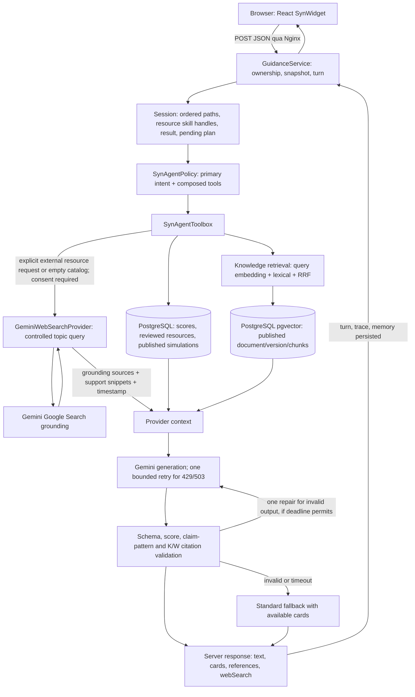

# Syn A/B/C: điều phối, RAG và nguồn học web

## Sửa theo phản hồi hội thoại ngày 2026-09-29

Tiếp tục ngày 2026-10-02: so sánh chung và giải thích khái niệm không tự lấy bằng chứng cá nhân. Toolbox chỉ gửi mô tả nghề cho comparison chung; không ghi “chưa làm bài” khi dữ liệu đơn giản là không được chọn. `PERSONAL_EVIDENCE_SCOPE` giúp provider phân biệt tập bằng chứng được chọn với toàn bộ lịch sử. Router tôn trọng “đừng đề xuất simulation”/“do not suggest simulations”. Câu hỏi dựa trên kết quả cá nhân vẫn đọc evidence có liên quan. Đây là kiểm soát lựa chọn ngữ cảnh, không phải đánh giá lại điểm hay mất memory.

HTTP adapter cho phép kết nối tối đa 5 giây, mỗi request theo cấu hình tối đa 20 giây, đồng thời luôn bị giới hạn bởi thời gian còn lại của lượt chat. Cấu hình 20 giây không còn bị trần request 10 giây âm thầm cắt bớt. Hết hạn vẫn hủy request và fallback; không retry vô hạn khi mạng/provider lỗi.

Free text ưu tiên generation khi có consent/provider; thiếu RAG không còn chặn generation. Model được phép giải thích kiến thức tổng quát và phải phân biệt với nguồn retrieved/verified; câu hỏi về tài liệu cụ thể còn thiếu phải báo thiếu. Một output repair có giới hạn được phép khi schema/claim/citation validation thất bại, không chạy lại tools, dùng cùng deadline 20 giây; nếu vẫn lỗi thì fallback. Native two-pass mode vẫn giới hạn hai passes và không có repair thứ ba. Ngân sách output STANDARD tăng lên tối đa 800 tokens, SHORT 400, vẫn bị chặn bởi cấu hình và trần 1000; giới hạn text 2400/suggestion 120 ký tự được đưa vào prompt/schema. Không thay scoring, consent hoặc kiểm soát citation.

SynAgentPolicy nhận DevOps/AI engineering là các topic ngoài catalog hiện tại, giữ đúng thứ tự và không kế thừa nhầm path cũ; tìm knowledge/web cho các topic này. Chúng chưa phải simulation mới hay hồ sơ nghề được review. PublicLearningQuery dùng vocabulary cố định mở rộng, gồm DevOps/AI/cloud tooling; truy vấn comparison giữ mục đích so sánh thay vì luôn tìm tutorial. Đây vẫn là router có vocabulary, chưa phải semantic planner hiểu mọi lĩnh vực.

SynWidget ưu tiên đoạn giải thích; comparison/results đóng mặc định trừ yêu cầu review kết quả. Citation summary ngắn `[A2]`, `[S3]`, `[K…]`; nội dung mở khi bấm. Comparison free text không thêm simulation nếu không hỏi. Web lỗi phân biệt RATE_LIMITED/ACCESS_DENIED với không có nguồn; catalog links không được coi là nguồn tìm web mới. Pending-plan follow-up gửi draft vào context để model diễn giải, không trả cứng một dòng.

Phạm vi được người dùng duyệt ngày 2026-09-29: tiếp tục P1/P2, chưa làm voice. Xem `plans/US-03-syn-coach-abc.md` và báo cáo kiểm thử tương ứng. Tài liệu mô tả implementation, không coi chất lượng model hay corpus draft là đã được nghiệm thu.

## A — Các thay đổi chính

- `SynAgentPolicy`: giữ primary intent tương thích API; hợp nhất resource, comparison, simulation, gap, plan và knowledge capabilities. Thứ tự path theo câu người dùng, “hướng đầu tiên/thứ hai” theo thứ tự hiển thị. Safety/save vẫn chặn việc tự gọi tool.
- `SynResourceMemory`: nhớ tối đa ba skill handles của resources đã hiển thị trong summary có giới hạn. “Tài nguyên thứ hai” chọn skill tương ứng, tải lại resource REVIEWED; không lưu thêm raw transcript. Result memory và pending plan đã có được dùng tiếp. Đây chưa phải memory ngữ nghĩa đầy đủ.
- `SynAgentToolbox`: exact skill + path trước; bổ sung resource cùng path khi thiếu. Không có skill thì không query lặp. Deduplicate theo URL. Plan EN/VI dựa trên resource, simulation và evidence gap; hỗ trợ khung một/hai tuần, vẫn cần người dùng xác nhận để lưu.
- Gemini generation retry tối đa một lần cho HTTP 429/503, tôn trọng Retry-After và deadline/consent. Không retry timeout hoặc malformed output để tránh tăng chi phí không rõ kết quả. Trace có PROVIDER_RETRY; lỗi HTTP phân biệt rate limited/unavailable.
- Validator thêm nhóm broad competence claims EN/VI. Đây là guard bằng mẫu ngôn ngữ, không phải bộ kiểm chứng ngữ nghĩa toàn diện và không bảo đảm phát hiện mọi suy diễn.

## B — Tình trạng RAG và publish

Tái sử dụng pgvector 768 chiều, full-text, RRF, top 5/10.000 ký tự, citation/version/revocation từ P1/P2. Plan và hướng dẫn kiến thức có thể gọi SEARCH_KNOWLEDGE. Knowledge thiếu không loại bỏ resource/plan hữu ích và không ngăn model giải thích kiến thức tổng quát với nhãn rõ; không được bịa nội dung tài liệu chưa có. Các đoạn retrieved là dữ liệu, không phải chỉ thị.

Corpus 20 tài liệu EN/VI trong `docs/data/knowledge/corpus.draft.json` chưa có human review. Bản đọc thuận tiện: `corpus-review.vi.md`. Không tự đổi reviewed/reviewer thành human-approved. Khi có manifest được duyệt, chạy `scripts/Publish-SynKnowledge.ps1 -Manifest <approved-file>`. Command dùng đúng Compose project và database hiện tại, không mở port và kết thúc sau ingestion. Các document publish riêng theo transaction/version; lỗi giữa corpus có thể để lại những document trước đó đã publish. Không tuyên bố held-out quality từ mock embeddings hay smoke test.

## C — Nguồn web

- Adapter Google grounding dùng GEMINI_API_KEY phía backend, `SYN_WEB_ENABLED` và `SYN_WEB_MODEL` (mặc định model chat).
- `PublicLearningQuery` chỉ gửi vocabulary skill và path được cho phép, không gửi raw user prompt, email, điểm, attempt ID hoặc transcript tới search. Hiện chỉ hỗ trợ tìm nguồn học IT theo topic; chưa giữ mọi ràng buộc tùy ý như chứng chỉ/giá/lịch học, chưa có tìm việc.
- Ưu tiên official publishers bằng search instruction; đó là ưu tiên, chưa phải domain allowlist bắt buộc. Nguồn hiển thị lấy từ groundingChunks và phải có groundingSupports; không dùng URL model tự viết trong prose. Yêu cầu HTTPS, host hợp lệ; backend không fetch URL kết quả hoặc theo redirect.
- Chỉ có timestamp lúc tìm; chưa chứng nhận trang còn mở được hoặc khóa học có chất lượng. Grounding redirect URL là nguồn provider trả về. Người dùng tự mở link để kiểm tra.
- Result có trạng thái LIVE_WEB/DISABLED/NO_CONSENT/NEEDS_TOPIC/UNAVAILABLE/NO_SOURCES. Kết quả live không được đánh dấu reviewed, không tự nhập vào corpus.
- Cache theo query trong một turn để fallback không search lần hai. Tối đa một search call/turn, tối đa ba nguồn. Provider có thể thực hiện nhiều search queries bên trong một call; chi phí search chưa nằm trong token pricing estimate.
- UI có panel Sources from the web và thời gian truy xuất. Search Suggestions do Google trả về được render qua sandboxed iframe không có script/same-origin privileges, không inject HTML vào DOM chính.
- Nếu có web sources và Gemini generation thất bại, sources vẫn hiển thị với provenance Standard. Consent được recheck trước mỗi external call và khi finalize response có web sources.

Tài liệu API nhà cung cấp: https://ai.google.dev/gemini-api/docs/generate-content/google-search . Search hỗ trợ phụ thuộc model/key/quota, cần kiểm thử live trên môi trường triển khai.

## Giới hạn vòng thực thi

Mặc định backend chọn tool rồi gọi generation, được thêm một lượt repair nếu output sai và còn ngân sách. Optional native planning vẫn tối đa hai model passes, model chọn tối đa bốn tools; backend bổ sung các capability bắt buộc, tổng không vượt tám identifiers hiện được định nghĩa. Không có loop tự do. Deadline request 20 giây; embedding, web và retry đều dùng chung ngân sách. Khung plan do backend tạo, model diễn giải chi tiết; không có autonomous write.
