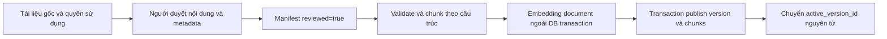

# Syn sau triển khai lõi và vector RAG — tài liệu vấn đáp

Phạm vi: giai đoạn P1/P2 của [plan đã duyệt](../../plans/US-03-syn-core-vector-rag-voice.md). Voice theo lượt và realtime chưa triển khai trong increment này. Kết quả kiểm thử thực tế và những gate chưa đủ bằng chứng nằm trong [báo cáo xác minh](../../.agent/reports/us-03-syn-core-vector-rag-verification.md).

## 1. Syn hiện là loại agent nào?

Syn là **agent có giới hạn**: nhận mục tiêu hội thoại, dùng policy/memory, chọn công cụ trong allowlist, chạy các công cụ đọc ở backend, rồi tổng hợp kết quả. Mặc định backend dùng `SynAgentPolicy` chọn tool xác định và gọi Gemini một lần để generation; cách này ổn định hơn giữa các Gemini model. Nhánh Gemini native tool planning hai lượt vẫn được giữ sau feature flag để thử nghiệm với model đã qua live test. Nhánh OpenAI cũng generation một lượt sau khi backend chọn công cụ. Standard không cần mô hình generation.

Không phải multi-agent, không chạy một mục tiêu vô hạn và không tự quyết định nghề nghiệp. “Reasoning” ở đây thể hiện qua lựa chọn công cụ và tổng hợp bằng chứng; hệ thống không lưu hay cần công khai chain-of-thought. RAG bổ sung tri thức tham chiếu, không biến điểm số thành dự đoán. Voice tương lai sẽ là phương thức nhập/xuất của cùng use case.

## 2. Bản đồ thành phần đang chạy

Các đường dẫn Java bên dưới bắt đầu từ `backend/src/main/java/edu/hcmute/careersim/guidance/`.

| Thành phần | File chính | Trách nhiệm và giới hạn |
|---|---|---|
| Cửa sổ chat | `frontend/src/features/guidance/components/SynWidget.jsx` | Chờ phản hồi, retry cùng mã yêu cầu, xem nguồn, xác nhận lưu kế hoạch, chỉ reset khi máy chủ xác nhận xóa |
| Adapter API | `frontend/src/features/guidance/api/guidanceApi.js` | Gửi clientMessageId; phục hồi phản hồi theo request ID khi mất mạng; không che lỗi 401/403 bằng Preview |
| HTTP controller | `controller/GuidanceController.java` | DTO/validation/principal, chuyển use case cho facade; không SQL, không prompt |
| Facade | `service/GuidanceService.java`, `service/impl/GuidanceServiceImpl.java` | Kiểm student active, dựng snapshot và lấy đúng attempt thuộc owner; phối hợp begin → agent → finish |
| Turn lifecycle | `service/SynTurnLifecycleService.java` | Transaction ngắn, khóa theo owner, idempotency, version, consent, xóa/hủy, recheck nguồn và commit nguyên tử |
| Turn persistence | `dao/SynTurnDao.java`, `dao/JdbcSynTurnDao.java` | SQL cho state/TTL/audit; không ra quyết định hướng nghiệp |
| Orchestrator | `service/SynAgentOrchestrator.java` | Giới hạn passes/tools, chọn provider, kiểm nguồn/điểm, dựng fallback, memory summary |
| Policy | `domain/SynAgentPolicy.java`, `domain/StandardGuidancePolicy.java` | Intent/path/language, safety boundary và câu trả lời xác định |
| Toolbox | `service/SynAgentToolbox.java`, `domain/SynToolIdentifier.java` | Chạy 7 công cụ được duyệt, trả dữ liệu theo công cụ, cô lập lỗi từng tool |
| Session memory | `dao/JdbcSynAgentDao.java` | Structured summary tối đa 600 ký tự, paths/intent, pending plan, version/expiry; không lưu raw transcript |
| Generation port | `service/SynGuidanceProvider.java` | Hợp đồng provider-neutral cho generate một lượt và planning/synthesis tùy chọn |
| Provider adapters | `infrastructure/GeminiSynGuidanceProvider.java`, `infrastructure/OpenAiSynGuidanceProvider.java` | Chuyển context thành request, kiểm toàn bộ response, parse JSON nghiêm ngặt |
| Output validator | `domain/SynReplyValidator.java` | Type/length/count/unknown fields, numeric-evidence guard và một số claim quá chắc chắn; không chứng minh tính đúng của mọi câu |
| Budget/transport | `service/SynExecutionScope.java`, `infrastructure/SynHttpRequests.java` | Deadline monotonic, recheck consent trước HTTP, tối đa 8 HTTP đang chạy, cancel future, giới hạn toàn body 256 KiB |
| Cleanup | `service/SynRetentionCleanup.java` | Xóa payload hết TTL, metadata hết hạn và session expired; phục hồi turn gián đoạn |
| Knowledge ingestion | `service/KnowledgeIngestionService.java`, `infrastructure/KnowledgeIngestionCommand.java` | Bắt buộc provenance/review, chunk/embed ngoài transaction, publish atomic; không phải công cụ cho LLM |
| Chunking | `domain/KnowledgeChunker.java` | Theo đoạn/heading, giữ code fence/table; từ chối block quá lớn để biên tập, không cắt mất nội dung |
| Embedding port/adapter | `service/EmbeddingProvider.java`, `infrastructure/GeminiEmbeddingProvider.java` | Document/query task riêng, 768 chiều, kiểm finite/nonzero và normalize |
| Retrieval | `service/impl/KnowledgeRetrievalServiceImpl.java`, `domain/HybridRetrievalPolicy.java` | Query minimization, vector + lexical, RRF, tối đa 5 chunks/10.000 ký tự; cache trong một lượt |
| Knowledge DAO | `dao/JdbcKnowledgeDao.java` | Exact cosine, full-text PostgreSQL, lọc published/active/profile, phiên bản và revoke |
| Evaluation runner | `infrastructure/KnowledgeEvaluationCommand.java` | Opt-in lexical/vector/hybrid cùng cases; không publish nguồn hay gọi generation; yêu cầu cases đã duyệt |

## 3. Tại sao không “đổi SQL thành vector database”?

SQL và vector giải quyết hai bài toán khác nhau:

- SQL là nguồn sự thật cho tài khoản, quyền, consent, điểm RIASEC, kết quả mô phỏng, kế hoạch và lượt chat.
- Vector là biểu diễn ngữ nghĩa của **văn bản tri thức được duyệt**, giúp tìm đoạn liên quan ngay cả khi từ ngữ không giống hệt.
- PostgreSQL vẫn giữ các bảng quan hệ, đồng thời extension pgvector thêm kiểu `vector(768)` và toán tử khoảng cách. Không phải xóa hay thay các bảng điểm.
- LLM không được query SQL, không tự chọn ID của sinh viên và không ghi điểm. `SEARCH_KNOWLEDGE` chỉ là một công cụ đọc.

Triển khai dùng exact cosine để có baseline dễ kiểm chứng; chưa thêm HNSW khi corpus còn nhỏ. pgvector hỗ trợ exact search và phối hợp full-text search trong cùng PostgreSQL. [Tài liệu pgvector](https://github.com/pgvector/pgvector/blob/master/README.md).

Profile embedding hiện cố định `gemini-embedding-001:768:retrieval-v1`; query dùng `RETRIEVAL_QUERY`, document dùng `RETRIEVAL_DOCUMENT`. Đây là lựa chọn triển khai cần benchmark EN/VI, không phải kết luận model tốt nhất. [Tài liệu Gemini embeddings](https://ai.google.dev/gemini-api/docs/embeddings).

## 4. Hai luồng RAG

### 4.1 Ingestion — ngoài hội thoại



Mỗi document có source key, title, URL tùy chọn, license, language, track và reviewer. Hash bao gồm nội dung cùng metadata quan trọng. Cùng hash/profile dùng lại version khi publish; hiện việc gọi lại ingestion vẫn có thể tính embedding trước khi phát hiện version đã tồn tại — tính idempotent của DB không đồng nghĩa không phát sinh phí embedding.

Embedding lỗi, sai dimension hoặc insert lỗi: version cũ tiếp tục active. Đổi model/profile phải re-embed tài liệu và publish version tương thích. Không trộn vector từ các profile khác nhau. Revoke đổi trạng thái document; cả retrieval và finalization kiểm tra lại trạng thái.

Corpus 20 documents ở `docs/data/knowledge/corpus.draft.json` là **bản nháp do AI soạn**, reviewed=false, chưa publish. Đây không phải 20 nguồn đã được người thật duyệt.

### 4.2 Retrieval và generation — trong một lượt

```mermaid
sequenceDiagram
  participant UI as Browser
  participant S as Guidance facade
  participant T as Turn lifecycle
  participant A as Agent
  participant K as Retrieval
  participant DB as PostgreSQL + pgvector
  participant L as Hosted model
  UI->>S: message + clientMessageId + sessionId
  S->>T: Snapshot ngắn / begin
  T->>DB: Owner, unique request, session version, PENDING
  T-->>S: turnId + session
  S->>A: Authorized snapshot
  opt Consent và provider sẵn sàng
    A->>L: Planning, tối đa 4 tools
  end
  A->>K: SEARCH_KNOWLEDGE khi cần
  opt Consent và embedding enabled
    K->>L: Query embedding đã giảm dữ liệu
    K->>DB: Exact vector search, cùng profile
  end
  K->>DB: Local lexical search
  K-->>A: RRF, chunks + immutable IDs/version
  opt Nguồn đủ và generation được phép
    A->>L: Evidence + passages như dữ liệu, không như chỉ dẫn
    L-->>A: Structured text + suggestions
  end
  A->>A: Validate schema / numeric guard / citation IDs
  A-->>S: Accepted AI hoặc Standard
  S->>T: Finish trong transaction ngắn
  T->>DB: Recheck state, owner, consent, nguồn; commit memory + response
  S-->>UI: turnId + reasonCode + cards + citations
```

Vector lấy tối đa 20 candidates với cosine similarity tối thiểu cấu hình 0,5. Lexical dùng normalized Vietnamese/English text với PostgreSQL simple full-text; OR keywords và loại stopwords. RRF dùng hằng số 60 để hợp nhất thứ hạng, không cộng trực tiếp hai loại score không cùng thang. Kết quả cuối tối đa 5 chunks và 10.000 ký tự.

Ngưỡng 0,5 và từ khóa OR là baseline cần hiệu chỉnh trên development set. Chưa có dữ liệu để hứa recall hay no-answer accuracy. Một từ khóa phổ biến vẫn có thể kéo đoạn không đủ liên quan; benchmark và human review còn cần thiết.

## 5. Vòng đời và fallback

| Tình huống | Hành vi thực tế |
|---|---|
| Không consent | Không gọi generation/query embedding; tools local + Standard/lexical |
| Quick action | Không gọi generation; policy xác định chọn tools |
| Provider timeout/quota/schema sai | Standard giữ objective cards, trace phân loại lỗi |
| Embedding lỗi | Lexical local; không retry embedding lần nữa trong cùng turn |
| Không có nguồn phù hợp | Nêu chưa có nguồn và đề nghị làm rõ; không bịa citation |
| Một tool lỗi | Đánh dấu degraded và dùng tool còn lại; lỗi SQL tool không giữ transaction làm hỏng commit sau |
| Citation ngoài retrieved set / source vừa revoke | Reject AI hoặc chặn finalize/replay; yêu cầu gửi lại khi source thay đổi |
| Gửi lại cùng owner/requestId/payload | Trả đúng response đã hoàn thành, không tạo turn mới |
| Cùng requestId nhưng payload khác | 409; không xử lý như yêu cầu mới |
| Một session đã có lượt PENDING | 409; UI chặn gửi trùng và có recovery theo request ID |
| User clear khi turn đang chạy ở client khác | Cancel/tombstone các turn, delete session; finalization không hồi sinh memory |
| Clear API thất bại | Giữ conversation và báo lỗi, cho thử lại |
| 401/403 hoặc DB lỗi lõi | Trả lỗi; không dựng personalized “live success” giả trên frontend |
| Turn bị gián đoạn | Sau 1 phút có thể được đánh dấu FAILED khi request recovery/begin hoặc cleanup; lần gửi mới dùng ID mới |
| Reply hết TTL | Không replay text cũ; metadata còn cho tới retention 30 ngày |

Budget external toàn lượt 20 giây, dành 2 giây cho kết thúc; HTTP generation tối đa 10 giây mỗi call và embedding tối đa 3 giây, luôn lấy min với remaining. Gateway chờ 30 giây. Đây là giới hạn ở tầng thực thi, không phải cam kết SLA khi DB/máy chủ quá tải.

Payload accepted response lưu tối đa 24 giờ, metadata/session tối đa 30 ngày; cleanup chạy sau khởi động và mỗi giờ. Session summary chứa state giới hạn và ID kết quả đang xem; ID này được kiểm lại owner/EVALUATED trước khi dùng cho follow-up, và không đưa marker nội bộ vào provider summary. Pending plan là draft server-owned. UI giữ transcript trong mounted tab, không phục hồi transcript của tài khoản trước từ browser storage. Reload trang bắt đầu UI mới; đây là đánh đổi có chủ đích khi production identity chưa được tích hợp.

## 6. Những gì validation bảo đảm và chưa bảo đảm

Có kiểm tra JSON đúng shape/type, duplicate keys/trailing tokens, control characters, số lượng/độ dài; Gemini kiểm mọi parts để không bỏ sót tool call nằm sau text. OpenAI cũng reject output type/tool bất ngờ và nhiều output_text.

Numeric guard chặn các pattern điểm phổ biến không khớp số trong evidence hiện hành. Citation guard kiểm ID thuộc lượt này, tồn tại và đúng version active. Backend giữ URL. Finalization giữ share lock nguồn trong transaction để publish/revoke không chen giữa kiểm tra và commit.

Các kiểm tra này **không chứng minh mọi factual claim được nguồn hỗ trợ**. Văn bản có thể sai về quan hệ, suy luận hoặc gán nhầm một con số đúng cho đối tượng khác. Cần chấm citation support và unsupported claims bằng người duyệt. Không báo “chống hallucination 100%”.

Trace lưu nguyên nhân thực thi và kiểu trả lời cuối thành hai trường riêng, timings theo phase, usage tokens khi provider trả về, tool statuses và knowledge versions; không log prompt/raw provider response. `SynUsagePricing` tính ước lượng USD bằng số token thực được báo và bảng giá pin theo provider/model/snapshot; tách planning/generation/query embedding. Nếu thiếu usage hoặc giá, tổng chi phí là unknown/partial, không ghi nhầm 0. Đây là giá chưa áp dụng discount, không phải hóa đơn. [Cấu hình và cách đọc cost trace](../deployment/syn-usage-cost.md).

## 7. Sau này thêm voice thế nào?

Giữ nguyên use case `sendMessage`:

1. STT nhận audio theo lượt, chuyển thành transcript EN/VI.
2. Người dùng xem/sửa transcript rồi xác nhận gửi.
3. Agent text chạy nguyên luồng trên và lưu accepted turn.
4. TTS chỉ đọc accepted response theo turn ID thuộc owner.
5. Cancel/playback/retention audio là lớp riêng, không cho transcript bỏ qua validation hay consent.

Realtime chưa bật. Muốn triển khai cần quyết định cách chốt turn, ngắt lời, cancel generation/TTS, kiểm nội dung trước phát tiếng và đo latency/cost. Không nên chỉ nối WebSocket rồi coi như đã giải quyết những vấn đề này.

## 8. Câu hỏi vấn đáp thường gặp

**RAG có thay memory không?** Không. Memory lưu trạng thái cuộc trao đổi; RAG tìm tri thức trong corpus; SQL evidence lưu kết quả cá nhân.

**Có cần một vector DB khác không?** Với quy mô hiện tại, PostgreSQL + pgvector giữ việc vận hành và transaction đơn giản. Có thể tách sau nếu đo đạc chứng minh cần.

**Vì sao vẫn lexical?** Từ khóa/tên chính xác có ích; đồng thời là fallback khi embedding unavailable hoặc không có consent. Vector vẫn là nhánh tìm ngữ nghĩa thực sự.

**Mô hình có chọn SQL không?** Không. Chỉ chọn tên tool trong enum, tham số công cụ không cho arbitrary SQL/owner IDs.

**Có tự lưu kế hoạch không?** Không. Chat tạo pending draft; endpoint lưu kế hoạch chỉ được UI gọi sau xác nhận. UI chỉ báo đã lưu khi server trả saved=true; lỗi giữ draft và cho retry, không đổi thành Preview success.

**Vì sao cần begin và finish riêng?** Để không giữ transaction qua network, nhưng vẫn ngăn trùng lượt và kiểm lại trạng thái trước commit.

**Có thể xóa trong lúc AI đang trả lời không?** Backend hỗ trợ cancel/clear và chặn finalization cũ. UI hiện chặn clear trong lúc chính tab đang chờ để tránh hứa xóa khi chưa biết session ID.

**Đã sẵn sàng production chưa?** Chưa. Production authentication/consent module, corpus review và benchmark generation/EN–VI là gate riêng còn thiếu. Các bài test kỹ thuật không thay thế các gate này.


Tham chiếu cá nhân dùng `A<assessmentAttemptId>` và `S<simulationAttemptId>` lấy từ snapshot đã kiểm quyền; các attempt hoàn tất là evidence bất biến, không có version của knowledge. Tham chiếu RAG dùng `K<chunkId>` cùng document version. Không trộn hai loại ID hoặc tạo URL cá nhân do model cung cấp.
