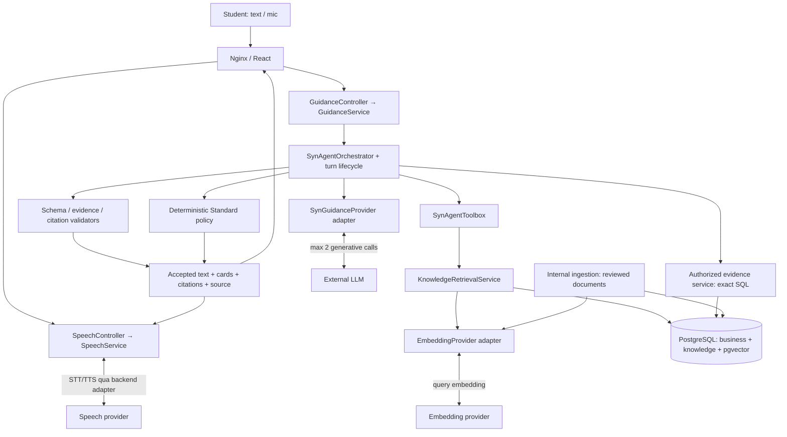

# US-03 — Kế hoạch củng cố Syn, vector RAG và voice Anh–Việt

Status: P1/P2 implementation delivered for technical review; quality/release gates remain open (2026-09-28)  
Date: 2026-09-28  
Frontend owner: Huỳnh Gia Hân (US-03). Backend/AI/DB/auth/operations owner: chưa được phân công; không suy diễn người phụ trách.  
Template: .agent/templates/feature-plan.md, mở rộng thành kế hoạch nhiều giai đoạn.

## 1. Scope, mục tiêu và quyết định kiến trúc

### 1.1 Nguồn và phạm vi

- Yêu cầu mới của người dùng: củng cố các điểm yếu đã phân tích; giải thích SQL/vector; lập plan áp dụng RAG; voice theo lượt; cân nhắc realtime.
- Baseline: US-03 trong [user-stories.md](C:/Users/huynh/Study/Exercises/Team/MTSE/career-simulation-platform/docs/requirements/user-stories.md); BR-03/04/09/10/11/12/13/16/18/19 trong PROJECT_CONTEXT.
- Audit đầu vào: [phân tích Syn hiện tại](C:/Users/huynh/Study/Exercises/Team/MTSE/career-simulation-platform/docs/architecture/syn-agent-rag-voice-analysis.vi.md), đặc biệt mục 6.
- Baseline cũ loại RAG khỏi increment tool-calling trước. Đây là scope extension được lập kế hoạch theo yêu cầu mới, không sửa ngược lịch sử hoặc gọi tính năng mới là đã implemented.
- Actor: student; người duyệt nội dung được phân công dùng ingestion nội bộ. Không tự mở rộng quyền của ENTERPRISE/ADMINISTRATOR hoặc làm CMS mới.
- Mục tiêu: Syn trả lời có evidence/citations, giới hạn quyền và chi phí rõ, hoạt động có fallback, dùng được text và voice VI/EN.
- Không thay objective scoring; không write tool cho LLM; không tự lưu plan; không thu thập answer keys vào knowledge corpus; không multi-agent/background autonomy; không public arbitrary file/URL ingestion.

### 1.2 Quyết định đề xuất

| ID | Quyết định | Lý do |
|---|---|---|
| D1 | Giữ modular monolith, controller → facade → service/domain → DAO/adapter | Tận dụng ranh giới có sẵn, trách nhiệm giải thích được |
| D2 | **RAG triển khai có embeddings + vector retrieval**, kết hợp lexical retrieval | Đáp ứng tìm theo ngữ nghĩa và giữ thuật ngữ IT chính xác |
| D3 | PostgreSQL + pgvector, trong các bảng knowledge riêng | SQL và vector cùng tồn tại, FK/version/backup thống nhất |
| D4 | Evidence cá nhân và score tiếp tục exact SQL lookup | Cần đúng owner và giá trị tuyệt đối, không gần đúng |
| D5 | Mặc định backend chọn tối đa 4 read tools rồi gọi Gemini một lần; native Gemini planning + synthesis tối đa 2 calls được giữ sau feature flag | Một lượt ổn định hơn giữa model; vẫn có đường thử nghiệm tool calling có ngân sách đo được |
| D6 | Provider-neutral typed tool results, shared output/citation validators | Cùng một ranh giới chất lượng cho Gemini, OpenAI compatibility và fallback |
| D7 | Voice giai đoạn đầu: STT → transcript review → Syn → TTS | Tận dụng lõi đã kiểm soát; dễ phân biệt lỗi nghe/tri thức/generation |
| D8 | Realtime trước hết thử streaming STT/TTS quanh cùng Syn backend | Giữ validation trước khi phát nội dung; native speech-to-speech là decision gate sau |

Các con số latency, chunk size, top-k và quality gates dưới đây là **mục tiêu/giá trị khởi đầu đề xuất**, không phải benchmark đã đạt.

### 1.3 Vì sao SQL và vector không mâu thuẫn?

SQL là ngôn ngữ truy vấn dữ liệu quan hệ; embedding là một biểu diễn số phục vụ tìm theo ngữ nghĩa. PostgreSQL có thể lưu cả cột thông thường, JSON và vector thông qua extension. Không phải chuyển toàn bộ database sang “dạng vector” hoặc xóa các bảng hiện có.

```text
PostgreSQL hiện có
├─ assessment/simulation/evaluation        ← sự thật nghiệp vụ, exact SQL
├─ syn_sessions / exploration_plans        ← trạng thái có ownership
├─ knowledge_documents / versions/chunks  ← văn bản + provenance, canonical knowledge
└─ knowledge_embeddings                   ← vector dẫn xuất để tìm đúng chunks
```

Embedding là **search index dẫn xuất**. Văn bản đã duyệt và metadata/version vẫn là nguồn để đọc, kiểm chứng, cập nhật. Retrieval trả chunk IDs + text; model không “đọc dãy vector” để trả lời.

Lần trước đề cập lexical baseline nhằm có đối chứng đánh giá, không phải vì SQL không tương thích. Trong plan này, vector retrieval là hạng mục bắt buộc ở P2, lexical là một nhánh của hybrid search và fallback khi embedding lỗi.

[pgvector chính thức](https://github.com/pgvector/pgvector) hỗ trợ exact/approximate vector search và phối hợp với full-text search. Exact vector search vẫn là semantic retrieval bằng embeddings; “exact” mô tả cách tìm hàng xóm, không có nghĩa chuyển về keyword search.

| Dữ liệu | Có vector hóa trong giai đoạn này? | Lý do |
|---|---|---|
| Tài liệu CareerSim tự viết/được phép sử dụng | Có, theo đoạn có ý nghĩa | Kho tri thức RAG chính |
| Reviewed path profiles, mô tả skill, hướng dẫn học có nội dung | Có thể tạo document version từ nội dung đã duyệt | Kết nối tri thức hiện có, tránh chỉ nhúng tiêu đề/link |
| Điểm RIASEC, điểm bài, task outcomes | Không | Lookup chính xác qua evidence API, không dùng nearest-neighbor |
| Account, consent, credentials, answer keys, evaluation rules | Không | Không thuộc corpus được phép |
| Raw chat/audio hoặc mọi file trong repo | Không | Không cần để đạt mục tiêu; tăng riêng tư và nhiễm instruction |
| Learning-resource URL | Chỉ metadata nếu chưa có quyền lấy full text | Lưu link không cấp quyền sao chép trang |

Nếu nguồn mô tả chung và evidence cá nhân có vẻ khác nhau, không để vector “sửa” evidence. Syn nói rõ kiến thức chung và dữ liệu thực tế của student đang cho thấy điều gì.

## 2. Lộ trình và acceptance criteria

### P0 — Chốt baseline kỹ thuật và bộ eval

Deliverables:

- Đóng băng tập câu hỏi/fixture synthetic; ghi commit + working-tree state dùng để đánh giá, provider/model/config khi chạy live.
- Phân biệt nguồn AI, STANDARD, PREVIEW, lý do degrade; ghi baseline cho latency/cost/tool choice trước tối ưu.
- Xác định corpus ban đầu 20–30 tài liệu nhỏ, bao phủ 5 tracks + giải thích RIASEC + cách đọc evidence. Ưu tiên tài liệu tự biên soạn.
- Lập manifest license/source/reviewer; chỉ tài liệu REVIEWED được publish.
- Ghi phụ thuộc auth/consent, phân công backend/DB/ops trước triển khai tương ứng; không coi local demo là production auth.

Exit: fixture tái lập được, câu hỏi và rubric có ground truth, nguồn được duyệt, không có dữ liệu thật trong demo.

### P1 — Củng cố lõi Syn

| ID / điểm yếu audit | Công việc cụ thể | File/lớp tác động chính | Acceptance criteria |
|---|---|---|---|
| C01 Schema/parser chưa chặt | Shared validator kiểm root object, required/type/length/count, unknown fields, Unicode/control chars; parse toàn candidate trước chọn text | Provider adapters; mới SynReplyValidator | Payload sai schema bị reject, không lặng lẽ sửa thành AI success |
| C02 Pass-2 tool call có thể nằm sau text | Duyệt mọi parts, reject bất kỳ tool call ở synthesis; test text-before-call/call-before-text/mixed | GeminiSynGuidanceProvider | Không có tool ngoài budget và mọi call dư bị phân loại đúng |
| C03 Prompt/keyword chưa đủ | Tách input boundary, structural validation, numeric/evidence-reference checks và semantic eval; content không được trở thành instruction | StandardGuidancePolicy; mới SynReplyValidator/grounding policy | Test injection VI/EN không đổi quyền/score/plan; không hứa regex chứng minh đúng mọi câu |
| C04 Timeout provider/gateway lệch | Deadline monotonic toàn turn, propagate remaining budget, timeout kết nối/đọc, bounded executor + cancellation; không retry vô hạn | Orchestrator, adapters, HTTP client, Nginx | Provider giả lập treo vẫn kết thúc trong budget; fallback còn thời gian trước proxy timeout |
| C05 Long transaction + tool SQL failure | Read snapshot trong transaction ngắn → đóng → network/tool transactions độc lập → final write ngắn; không giữ transaction/row lock qua HTTP | GuidanceServiceImpl; mới SynTurnLifecycleService hoặc TransactionTemplate | DB pool không bị giữ vì LLM; PostgreSQL SQL error ở tool không làm final-write transaction bị aborted |
| C06 Concurrency/idempotency | clientMessageId, unique(owner, requestId), payload hash, server turnId; một in-flight turn/session; version check + session deletion epoch | DTOs, turn/session DAO, migration, API client | Retry không tạo audit/turn trùng; requestId reused với payload khác bị conflict; không ghi đè memory mới |
| C07 Tool payload lặp/cắt thông tin | ToolObservation typed theo tool: status, selected evidence, path/resource data, plan draft; token budget theo loại | Toolbox, provider port/adapters | Không lặp toàn dashboard cho từng tool; không chỉ gửi “có 3 resources”; nguồn quan trọng không mất do limit danh sách |
| C08 Intent/path bằng keyword | Giữ router deterministic, chuẩn hóa aliases, phân biệt explicit career path với kỹ năng nhắc trong câu; mơ hồ thì clarify | SynAgentPolicy + tests | Câu “frontend cần SQL không” không tự ép thành so sánh hai nghề; follow-up VI/EN có expected intent/path |
| C09 Memory thiếu state hữu ích | Versioned structured state: selected path/result IDs, pending server-owned plan ID, current question slot; reauthorize IDs khi đọc | Session DAO/orchestrator/domain memory | Hiểu “bước thứ hai của kế hoạch đó” từ plan state, không phải tự bịa; bounded schema, không raw transcript mặc định |
| C10 Clear/expiry không đồng nghĩa delete | DELETE idempotent theo owner, local state CLEAR_PENDING/FAILED, retry rõ; cleanup expired sessions; không hồi sinh session khi reply muộn | guidanceApi, SynWidget, session lifecycle/DAO | Xóa báo thành công chỉ khi server xác nhận; in-flight turn không recreate memory sau clear |
| C11 Audit thiếu onboarding và failure detail | Turn metadata riêng không bắt buộc evidence FK: traceId, source, reason, model, timings, tool statuses, knowledge versions | mới syn_turns/SynTurnDao; GuidanceDao adapter | Cả no-evidence và fallback có trace; không log prompt/audio/raw provider response |
| C12 Citations chưa có identity | Mở rộng reference thành typed EVIDENCE hoặc KNOWLEDGE; immutable IDs/version/section; backend sở hữu URL | DTOs, validators, UI | Citation chỉ được trỏ dữ liệu của lượt hiện tại và đúng quyền |
| C13 Core DB failure bị nhầm AI fallback | Phân loại auth/domain/DB/provider riêng; core DB failure trả safe service error, UI không giả lập live success | Service, error mapping, frontend adapter | 401/403 không biến thành live personalized guidance; preview chỉ ở mode demo rõ ràng |
| C14 Runtime auth/consent | Tích hợp production identity khi module được giao; revalidate account/consent trước external calls; không dùng demo principal public | StudentAccountAccess, SecurityConfig, identity integration | Wrong role/owner/locked/consent revoked bị chặn; demo disabled production |
| C15 Evidence cũ ngoài 10 kết quả | requestedAttemptId lookup trực tiếp theo owner + EVALUATED; recent list chỉ cho dashboard | SimulationEvidenceAccess/implementation, service | Owned completed attempt cũ đọc được; ID của người khác vẫn 404/forbidden theo contract |
| C16 Provider parity/confirmation | Chung validator/tool-result contract; giữ OpenAI 1-pass compatibility có test; DRAFT_PLAN vẫn server-owned | Provider port/adapters, plan service | Provider nào cũng không được lưu plan; no consent/quick actions không gọi generative model |

Auth integration là dependency cho release public, không phải lý do ngăn lập trình và test lõi với fixtures. Owner frontend của các story khác vẫn phải được tôn trọng khi nối consent/login.

Đề xuất budget khởi đầu để test: server text turn 20s (snapshot 1s, planning 4s, retrieval/tools 3s, synthesis 9s, validation/finalize/fallback 3s); gateway > server (ví dụ 25s), client > gateway (ví dụ 30s). Đây là trần, không là latency mong đợi hoặc bảo đảm mỗi bước sẽ dùng hết. Test hợp đồng timeout phải bao gồm cả DNS/connect/read và hủy công việc; nếu stack HTTP không hỗ trợ deadline thật thì cần đổi adapter transport thay vì chỉ bọc Future rồi bỏ mặc request đang chạy.

Cơ chế transaction cụ thể: service điều phối không @Transactional toàn sendMessage; dùng một bean lifecycle giao dịch ngắn hoặc TransactionTemplate để tránh self-invocation làm annotation mất tác dụng. Tool DAO reads có transaction riêng; không dùng distributed transaction với provider. Clear/consent revoke trong lúc generation phải làm lượt cũ không được persist/play như còn hiệu lực.

Exit P1: C01–C16 có test/evidence phù hợp; DB integration bắt buộc chạy thật, không tính skip là pass; AI success và Standard đều giữ nguyên objective scores.

### P2 — Vector RAG đầy đủ, có nguồn và lifecycle

Deliverables: corpus manifest, ingestion/index version, embedding adapter, hybrid retriever, SEARCH_KNOWLEDGE tool, citation-aware generation/validation/UI, benchmark.

| ID | Acceptance criteria |
|---|---|
| R01 | Chỉ chunk từ document version đã REVIEWED/PUBLISHED/active và trong scope được đưa vào context |
| R02 | Query embedding và document embeddings cùng model profile/version/dimension; mismatch fail closed |
| R03 | Semantic vector retrieval hoạt động thực sự; lexical-only, vector-only và hybrid được đo trên cùng held-out dataset |
| R04 | Claim dựa tri thức có chunk citation; citation ID/URL/version được backend đối chiếu retrieved set |
| R05 | Không tìm đủ nguồn → answer nêu thiếu nguồn/clarify hoặc Standard; không bịa nguồn |
| R06 | Document thay đổi → version mới; failed ingest không làm mất version đang hoạt động; publish atomic |
| R07 | Thu hồi document loại nó khỏi retrieval/cache; recheck visibility trước final output |
| R08 | Injection trong chunk không thay tool permissions, scoring, system rules hoặc plan confirmation |
| R09 | Không embedding toàn bộ student evidence/raw dialogue; query gửi provider đã minimization và có consent |
| R10 | Cả Gemini bounded branch và OpenAI compatibility nhận được typed knowledge context; Standard có đường local lexical phù hợp |
| R11 | Số calls/tokens/cost/latency của embedding và generation tách riêng trong trace |
| R12 | Schema/migrations/pgvector build và backup/restore được kiểm tra với PostgreSQL thật |

Exit P2: phải có ablation và citations được human review; không coi “trả được câu trả lời” là bằng chứng RAG tốt.

### P3 — Voice theo lượt

Deliverables: speech ports/adapters, endpoint STT/TTS có ownership, transcript editor, UI state machine, deployment policy và song ngữ eval.

| ID | Acceptance criteria |
|---|---|
| V01 | VI và EN: ghi âm → transcript → sửa/gửi → Syn → nghe, đều có text |
| V02 | Chỉ final transcript được người dùng gửi mới tạo agent turn; interim transcript không gửi nhiều lần |
| V03 | TTS chỉ đọc server-accepted text của turn đúng owner; không thành endpoint đọc text tùy ý vô hạn |
| V04 | Denied mic/unsupported codec/silence/STT timeout → nhập text; TTS lỗi → giữ answer và retry audio riêng |
| V05 | Stop/cancel/new turn ngừng phát và loại response muộn; không tự thu lại tiếng TTS |
| V06 | Input language, response language, TTS voice được quản lý riêng và hiển thị rõ |
| V07 | Audio không persist mặc định; browser mic permission không thay thế consent gửi speech cho external provider |
| V08 | Headers/CSP/HTTPS/upload limit/codec được test qua gateway và browser thật |
| V09 | Không tự lưu plan qua câu nói; explicit confirmation control vẫn bắt buộc |
| V10 | Không âm thầm cắt transcript >600 ký tự; báo sửa ngắn lại; nâng giới hạn cần AC riêng |

Exit P3: E2E VI/EN + permission/error/cancel/accessibility; benchmark audio trên câu IT và giọng đã định nghĩa, không chỉ fixture “hello”.

### P4 — Cân nhắc realtime bằng một thử nghiệm có gate

P4 là nghiên cứu/PoC, chưa mặc định đưa vào MVP. So sánh P3 với streaming STT + validated-text TTS trước, rồi mới đánh giá native speech-to-speech.

Go khi: cùng quyền/evidence/citations/fallback, giảm p95 time-to-first-audio ít nhất 30% so với P3 trên cùng tập/thiết bị/mạng; stop audio sau thao tác interrupt trong 300ms phía client; không late-turn contamination; cost nằm trong cap đã chốt; quy tắc validation trước phát vẫn được giữ.

No-go khi: phải bỏ backend ownership/validation để đạt latency, trả lời được phát trước khi policy kiểm, reconnection làm chạy trùng tool, không bảo đảm voice VI/EN, hoặc không có lợi ích đo được. Native audio sinh trực tiếp không mặc nhiên đáp ứng yêu cầu “text đã kiểm rồi mới phát”; nếu không giải quyết được thì giữ P3/streamed cascade.

## 3. Kiến trúc RAG và trách nhiệm

### 3.1 Topology đề xuất



Đây là sơ đồ mục tiêu, không thay cho sơ đồ trạng thái hiện tại khi chưa implement. Provider keys luôn ở backend. Speech adapter không được gọi LLM trực tiếp để bỏ qua Orchestrator.

### 3.2 Thành phần RAG đối chiếu hệ thống

| Thành phần RAG chuẩn | Vai trò | Tương ứng với CareerSim và file dự kiến |
|---|---|---|
| Corpus/source registry | Nội dung, quyền sử dụng, reviewer, freshness | Mới knowledge_documents/versions + manifest trong docs/data/syn-knowledge |
| Loader/parser | Chuyển tài liệu được duyệt thành nội dung sạch | Mới KnowledgeIngestionService + parser; MVP Markdown/plain text, không OCR pipeline |
| Chunker | Chia theo heading/đoạn, giữ ngữ cảnh và section ID | Mới KnowledgeChunker trong guidance/domain |
| Embedding model | Biến query/document thành vector tương thích | Mới EmbeddingProvider port + GeminiEmbeddingProvider adapter ban đầu |
| Vector store | Lưu/query vector, liên kết về chunk | PostgreSQL pgvector + KnowledgeDao/JdbcKnowledgeDao |
| Lexical search | Giữ acronym, tên task, keyword chính xác | PostgreSQL full-text + normalization/aliases có test VI |
| Hybrid retriever | Lọc scope, lấy candidates, hợp thứ hạng, chọn context | KnowledgeRetrievalServiceImpl + HybridRetrievalPolicy |
| Context builder | Đóng gói source IDs/text, budget, phân biệt knowledge/evidence | Nâng typed ToolObservation + mới SynContextAssembler nếu logic đủ lớn |
| Generator | Tổng hợp trên evidence + retrieved text | Gemini/OpenAI SynGuidanceProvider hiện có, mở rộng contract |
| Citation validator | Kiểm claim references nằm trong set hợp lệ | SynReplyValidator + KnowledgeCitationPolicy |
| Output renderer | Hiển thị câu trả lời và nguồn để kiểm chứng | SynMessageResponse + SynWidget/CitationList |
| Evaluation/trace | Đo retrieve đúng, trả lời đúng, latency/cost | eval fixtures + SynTurnDao trace metadata |

Tên file mới là đề xuất. Mỗi lớp chỉ tạo khi có trách nhiệm cụ thể; không thêm framework/manager trùng chức năng.

### 3.3 Data model và đồng bộ SQL–vector

Bảng dự kiến:

- knowledge_documents: document_id, canonical_key/source_url, title, publisher/license, visibility, active_version_id, status.
- knowledge_document_versions: version_id, document_id, content_hash, language, track/tags, source_revision, reviewed_by/at, status.
- knowledge_chunks: chunk_id, version_id, ordinal, heading/section, text, token_count, lexical index.
- knowledge_index_versions: index_version_id, embedding_model, dimension, task/prompt profile, normalization, chunker_version, status.
- knowledge_embeddings: chunk_id, index_version_id, embedding vector(n), unique(chunk_id, index_version_id).
- syn_turns: owner/session/request IDs, state, provenance/reason, model/config versions, timings/tool status/citation identities; response storage theo retention riêng.

Không chỉnh migration V9. Tạo migrations kế tiếp còn trống khi bắt đầu implement, kèm indexes/FKs/uniqueness và rollback ứng dụng bằng feature flag.

Giá trị thử nghiệm ban đầu: 768 dimensions, cosine distance; exact vector search khi corpus nhỏ. 768 vừa đủ gọn để benchmark; chưa kết luận tốt nhất. pgvector HNSW với kiểu vector có giới hạn dimensions cần kiểm khi chọn model; không lấy output mặc định 3072 rồi giả định mọi cấu hình index đều dùng được. [Tài liệu pgvector](https://github.com/pgvector/pgvector)

Model embedding phải được pin trong index profile sau spike EN/VI. Candidate: Gemini embedding đang được hỗ trợ, lấy text input. Adapter phải áp dụng đúng hướng dẫn riêng của model về query/document task hoặc instruction và normalization; không copy task_type của model cũ sang model mới. [Gemini Embeddings](https://ai.google.dev/gemini-api/docs/embeddings)

Đồng bộ:

1. Hash source/content để ingestion lặp lại không tạo duplicate.
2. Build chunks/embeddings cho version/index mới ở trạng thái STAGING.
3. Retry ingestion có checkpoint; batch quota/backoff, không chạy trong student request.
4. Validate mọi chunks bắt buộc đã indexed, dimension/model đúng, source reviewed.
5. Publish bằng transaction ngắn cập nhật active version/index pointer.
6. Runtime chỉ query active pair. Không trộn embeddings của model khác chỉ vì số chiều giống nhau.
7. Revoke source → loại ngay khỏi eligibility, invalidate cache; cleanup vector có thể chạy sau.
8. Đổi model/dimension → tạo index/table/partition tương thích riêng, backfill và switch; không overwrite nửa kho.
9. Cache theo corpus/index version + query + scope; không dùng cache cá nhân chung.

Compose hiện dùng postgres:17-alpine. Chọn/build image PostgreSQL 17 có extension pgvector, pin version/digest; test restore bản backup trong volume thử trước chuyển môi trường chính. Không đổi major PostgreSQL hoặc xóa volume để “cài vector”.

### 3.4 Ingestion chuẩn

Manifest được duyệt → parse → bỏ nội dung không thuộc phạm vi → chunk theo heading/paragraph → metadata/version → document embeddings → lưu STAGING → eval kiểm tra → publish.

Tham số khởi đầu: khoảng 350–600 tokens/chunk, overlap 50–80 tokens khi có ích, không cắt đôi code block/bảng/ngữ nghĩa. Có heading/document title trong embedding input; lưu text gốc để citation. Nếu dùng tokenizer xấp xỉ phải ghi rõ và kiểm hard token limits của provider.

Corpus có thể có EN/VI; không ép hard filter “query VI chỉ tìm document VI” vì cần cross-language retrieval. Ưu tiên nguồn cùng ngôn ngữ khi chất lượng tương đương, vẫn cho tài liệu EN hỗ trợ câu trả lời VI.

Không ingest URL tùy ý từ user chat. Ingestion MVP là CLI/job nội bộ với nguồn allowlisted đã review. Nếu sau này lấy URL trực tiếp thì cần SSRF/redirect/content-size controls và quyền sử dụng nguồn, không biến tool agent thành trình duyệt tự do.

### 3.5 Query chuẩn và ghép vào hai pass

1. Service xác thực + chụp snapshot evidence/memory đúng owner; xác định request ID và deadline.
2. Policy nhận diện needKnowledge bằng intent/đặc điểm câu hỏi; định nghĩa knowledge-required cho câu hỏi giải thích nội dung tài liệu. Câu hỏi điểm cá nhân thuần túy có thể bỏ retrieval.
3. Mặc định `SynAgentPolicy` chọn tools xác định. Nếu bật thử nghiệm native planning, pass 1 Gemini chỉ được chọn parameterless read tools trong allowlist. SEARCH_KNOWLEDGE luôn dùng sanitized message + selected track/skill context do server lập; model không được đặt SQL, URL hoặc studentId.
4. Với knowledge-required, backend bắt buộc thêm SEARCH_KNOWLEDGE theo policy trong giới hạn 4 tools và ghi trace điều chỉnh; không để câu hỏi bắt buộc nguồn được trả lời chỉ bằng model memory.
5. Query minimization loại student name/IDs/score không cần cho tìm tri thức; embedding chỉ chạy nếu consent external phù hợp.
6. Embed query → vector candidates khoảng top 20; lexical candidates top 20. Filter scope/published/version trong từng nhánh, không chỉ sau khi đã lộ text.
7. Dedupe và Reciprocal Rank Fusion với tham số khởi đầu k=60; chọn tối đa 5 chunks và khoảng 3000 tokens. Đây là thứ hạng, không là xác suất câu trả lời đúng.
8. Calibrate relevance/no-answer bằng tập development; không coi mọi top-k là đủ tin cậy và không dùng ngưỡng cosine chung cho mọi model.
9. Context assembler ghép separately: student evidence, session state, knowledge chunks/source IDs. Chunks là data không đáng tin, không phải instructions.
10. Pass 2 tạo schema gồm text/answer sections, reference IDs, suggestions. Citation đặt theo đoạn/claim có scope rõ; server dựng URL/label từ metadata.
    Điều chỉnh output-token budget theo schema mới và response depth; budget 450 tokens hiện tại phải được đo lại vì citations chiếm thêm token. Giữ giới hạn text/hard token cap rõ, reject response bị cắt thay vì hiển thị JSON dở dang.
11. Validate toàn payload + membership nguồn + score/reference invariants; recheck document visibility và turn/session validity trước finalize.
12. Persist response/metadata theo retention, cập nhật memory bằng optimistic version; trả text/cards/citations/provenance.
13. No-answer → nêu giới hạn/clarify; lỗi model/output → Standard. Không dùng generated correction loop thứ ba trong MVP.

OpenAI compatibility: Java chọn tools gồm SEARCH_KNOWLEDGE theo cùng policy, retrieve rồi generate một pass. Quick actions/no consent: không gọi embedding/LLM bên ngoài; có thể local lexical trên corpus public reviewed và Standard. Resource/simulation cards vẫn do backend dựng.

## 4. Flow inventory: voice, realtime và fallback

### 4.1 Voice theo lượt — luồng thành công

1. Student chọn input locale VI/EN, response language và voice tương ứng; UI có AUTO chỉ khi provider/region đã được test, không hứa tự nhận dạng hoàn hảo.
2. Bấm mic; browser hỏi permission, chỉ ghi khi được cấp; hiển thị recording và timer.
3. Dừng ghi → gửi file tới STT endpoint. Giới hạn đề xuất 30s/utterance và 5 MiB/file; kiểm dung lượng lẫn duration, MIME/codec thực chứ không chỉ extension.
4. Backend kiểm student/consent/rate/budget; SpeechService gửi adapter STT, không giữ transaction trong cuộc gọi mạng.
5. STT trả transcript + detected locale nếu có; UI cho sửa, giữ nguyên technical terms khi có thể.
6. Người dùng bấm Send → POST Syn message với clientMessageId, chính pipeline P1/P2. STT không có quyền tạo plan/write tool.
7. Syn text thành công hiển thị ngay; TTS là bước riêng, không chặn việc đọc text hoặc thao tác nguồn.
8. Nếu bật Read aloud, backend resolve turn đúng owner rồi dùng accepted spoken text: lấy từ validated answer, bỏ markup/link syntax có quy tắc, không thêm ý nghĩa mới.
9. Audio trả theo content type đúng; browser phát, có Stop/Replay; TTS fail chỉ retry speech, không gọi lại cả agent.

State machine UI:

```text
IDLE → RECORDING → TRANSCRIBING → REVIEW_TRANSCRIPT → SUBMITTING
     → ANSWER_READY → SYNTHESIZING → SPEAKING → IDLE
Mỗi trạng thái có ERROR / CANCEL theo loại;
cancel hoặc new turn làm tăng client generation ID để bỏ response muộn.
```

Không phải mọi state đều phải khóa input: TTS đang phát có thể dừng để nhập câu mới; trong cùng server session chỉ một agent turn in-flight. Recording mới dừng playback cũ để tránh self-echo.

Thành phần: SpeechController chỉ transport; SpeechService kiểm use case/consent/turn ownership; SpeechToTextProvider và TextToSpeechProvider là ports; Cloud adapters làm codec/request/error mapping; useSynVoice giữ UI state; SynWidget tái sử dụng text/core.

Ứng viên STT/TTS: Google Cloud dịch vụ riêng với VI/EN trong danh sách hỗ trợ. Chốt model/voice/region theo live eval và billing account sẵn có; không giả định Gemini key dùng được cho mọi Cloud API. [STT](https://docs.cloud.google.com/speech-to-text/docs/speech-to-text-supported-languages), [TTS](https://docs.cloud.google.com/text-to-speech/docs/list-voices-and-types)

Speech deadline đề xuất: STT server 10s sau upload, TTS server 8s tới response/first-audio tùy API; gateway/client timeout lớn hơn tương ứng. Tách endpoints để không cộng STT+LLM+TTS vào timeout một request. Nếu audio decode/transcode cần CPU, có worker concurrency/size limit và timeout; không chạy process codec vô hạn.

Deployment: sửa microphone policy ở cả gateway/frontend Nginx và xem security headers; enable self origin phù hợp, không wildcard; HTTPS/localhost; CSP media-src cho self/blob nếu dùng; upload limits chỉ endpoint speech; codec feature detection ở browser, kiểm bytes/duration server; revoke object URLs và stop media tracks khi cancel/unmount.

### 4.2 Realtime — hai kiến trúc cần so sánh

**RT-A: streamed cascade, giữ lõi Syn.** Browser stream audio → backend STT partial; VAD/explicit end turn → final transcript → Syn + retrieval → validate completed answer → TTS stream. Cho barge-in ở client và cancel server; không gửi mọi partial transcript vào agent. Nó cải thiện upload/STT/playback nhưng không tự loại latency hai pass LLM.

**RT-B: native speech-to-speech.** Stateful audio session với provider realtime, tools do backend phê duyệt, có reconnect/VAD/turn IDs và citations đồng bộ. Đây là thay đổi adapter/orchestration lớn hơn. Native model có thể phát audio trước khi ứng dụng kiểm nội dung; nếu muốn giữ “validate-before-play”, phải buffer/kiểm trước hoặc dùng constrained content pipeline, điều này có thể làm mất lợi ích latency.

[Gemini Live](https://ai.google.dev/gemini-api/docs/live-api) có realtime streaming và tool use; khả năng provider không chứng minh đã đáp ứng Syn product rules. Theo kiến trúc project hiện tại, ưu tiên server-to-server; không tự mở frontend-to-LLM bypass.

Work items P4:

- RT01 đo bottleneck P3 và baseline cost/time-to-first-audio.
- RT02 PoC RT-A với stream framing, final transcript commit và backpressure.
- RT03 interrupt/reconnect: stop playback, cancel generation/TTS, stale-turn guard, replay chỉ kết quả known-complete; không repeat side effects.
- RT04 thử native adapter trên fixtures synthetic, kiểm grounding + citations + moderation trước phát.
- RT05 quyết định ADR Go/No-go với kết quả cùng tập VI/EN, network và hardware.

Không tự nâng max provider passes để đạt realtime. Nếu PoC cần ngân sách/session/token khác, ADR phải ghi khác biệt thay vì gọi đó là cùng flow hai pass.

### 4.3 Ma trận alternate/exception/fallback chung

| Tình huống | Kết quả mong muốn | Trace/UX |
|---|---|---|
| AI disabled/no external consent | Standard với evidence đúng quyền; local reviewed retrieval nếu thích hợp | STANDARD + reason, không external request |
| Gemini planning không hợp lệ | Deterministic plan + Standard | INVALID_TOOL_PLAN |
| Một optional tool fail | Các tool khác tiếp tục; bỏ claim phụ thuộc tool lỗi | PARTIAL_TOOLS + cụ thể tool |
| Knowledge-required nhưng không có nguồn | Clarify/no-supported-answer; không bịa nội dung có nguồn | NO_RELEVANT_KNOWLEDGE |
| Embedding fail/quota/deadline | Local lexical fallback nếu còn budget và đủ relevant; nếu không no-answer | EMBEDDING_UNAVAILABLE / LEXICAL_ONLY |
| Vector query fail | Dùng lexical qua transaction/connection còn lành; DB toàn hệ thống fail → service unavailable | Không che DB failure bằng AI success |
| Citation/schema invalid | Standard; không thêm generative repair call trong MVP | INVALID_OUTPUT |
| Provider timeout/quota | Standard từ snapshot evidence hợp lệ | PROVIDER_TIMEOUT / PROVIDER_REJECTED |
| Final persistence fail | Trả safe error; không tuyên bố memory/plan đã lưu | TURN_FINALIZE_FAILED |
| Consent revoked/account locked/session cleared khi đang chờ | Hủy/không final output trái quyền; không TTS | TURN_INVALIDATED |
| Retry cùng requestId và cùng payload | Trả cached accepted response hoặc pending state; không tạo turn thứ hai | IDEMPOTENT_REPLAY |
| Crash lúc đã gọi provider, chưa finalize | Mark interrupted/unknown; không tự gọi lại không giới hạn | Không hứa exactly-once billing phía provider |
| Wrong owner/role | Từ chối theo API contract; không Preview giả personalized | AUTH_REQUIRED/FORBIDDEN/NOT_FOUND |
| Mic denied/unsupported | Text input vẫn hoạt động | Voice unavailable rõ ràng |
| Silence/STT uncertainty/failure | Sửa transcript/thu lại; không gửi bừa | STT_ERROR hoặc transcript review |
| TTS failure | Text và citations còn nguyên; replay audio riêng | TTS_UNAVAILABLE |
| Stop/cancel | Dừng audio, hủy công việc còn có thể hủy, bỏ late response | CANCELLED; không auto resume cũ |
| Session expiry | Tạo phiên mới có thông báo; cleanup theo retention | Không đồng nhất expiry với đã xóa mọi audit |

DB connection pool exhaustion/core auth failure không thuộc “LLM fallback” và không thể hứa phục hồi bằng template nếu không có authorized evidence.

## 5. Change surface và API contract dự kiến

### 5.1 File map

Base backend: backend/src/main/java/edu/hcmute/careersim/guidance. Các tên dưới đây là thay đổi dự kiến, chưa tạo implementation.

| Nhóm | Existing cần sửa | New dự kiến |
|---|---|---|
| Core orchestration | service/SynAgentOrchestrator.java; service/impl/GuidanceServiceImpl.java; service/SynGuidanceProvider.java | SynTurnLifecycleService + impl, SynTurnDao/JdbcSynTurnDao; SynReplyValidator; typed SynMemory/ToolObservation |
| Routing/tools | domain/SynAgentPolicy.java; domain/SynToolIdentifier.java; service/SynAgentToolbox.java | HybridRetrievalPolicy, KnowledgeCitationPolicy |
| Providers | infrastructure/GeminiSynGuidanceProvider.java; OpenAiSynGuidanceProvider.java | EmbeddingProvider port + GeminiEmbeddingProvider adapter |
| RAG | DAO/resource contract khi link với reviewed profiles | KnowledgeRetrievalService + impl; KnowledgeDao/JdbcKnowledgeDao; KnowledgeChunker; KnowledgeIngestionService/job |
| Speech | GuidanceService turn lookup/accepted response access | SpeechController, SpeechService + impl, SpeechToTextProvider, TextToSpeechProvider và Cloud adapters |
| DTO | SynMessageRequest/Response.java, evidence references | SpeechTranscriptionResponse, SpeechSynthesisRequest, KnowledgeCitation DTO |
| DB | Không sửa shared migrations cũ | Migrations mới: turn/session version, knowledge schema, pgvector/indexes; optional retention cleanup support |
| Frontend | SynWidget.jsx, guidanceApi.js, synTranscript.js, shared/api/httpClient.js | hooks/useSynVoice.js, components/SynVoiceControls.jsx, CitationList.jsx; component/integration tests |
| Evidence history | simulation/access/SimulationEvidenceAccess + Jdbc implementation | Owned completed attempt lookup method |
| Deploy | docker-compose.yml, application.yml, .env.example, SecurityConfig, cả hai Nginx configs | Pin pgvector image/build, config flags, ops docs; không sửa secrets .env |
| Docs/eval | docs/api/README.md, docs/architecture/README.md, docs/deployment/README.md, requirements/AC và report khi implement | Corpus manifests, eval datasets/results, ADR cho embedding/voice/realtime, per-phase evidence/logs |

### 5.2 API dự kiến

Base /api/v1/guidance. Đảm bảo additive compatibility hoặc version endpoint nếu client cũ không tương thích.

| Method/path | Input | Output/hành vi | Failure |
|---|---|---|---|
| POST /syn/messages | Existing + clientMessageId, optional expectedSessionVersion | Existing response + turnId, reasonCode, typed citations/retrievalStatus | Validation, conflict, forbidden, safe unavailable |
| GET /syn/turns/{turnId} | Authenticated owner | PENDING/COMPLETED/FAILED/CANCELLED + accepted response khi có; phục vụ retry/reconnect | Not found ngoài owner; gone sau retention |
| DELETE /syn/sessions/{sessionId} | Owner | Idempotent clear + invalidate in-flight; clear local khi confirmed | Authorization/service error rõ |
| POST /speech/transcriptions | Multipart audio + inputLocale + clientCaptureId | transcript, detectedLanguage khi provider có, duration; chưa tạo Syn message | Unsupported media, payload too large, silence, timeout/quota |
| POST /speech/synthesis | turnId + allowed voiceId + locale | Audio của response đúng owner; text lấy server-side | Wrong owner, expired turn, voice unsupported, timeout |
| POST /syn/turns/{turnId}/cancel | Owner | Mark cancel + best-effort remote cancellation | Idempotent; state race theo contract |
| POST /plans | Existing explicit confirmation | Saved plan | Không được gọi bởi model/audio tự động |

Idempotency key là dedupe request trong server DB, không bảo đảm provider exactly-once qua mọi crash/network failure. Xác nhận plan có idempotency riêng nếu cần; không gắn “save” vào tool synthesis.

Evidence/knowledge references: loại nguồn, reference ID, document version/section hoặc owned evidence identity, safe title/URL do backend tạo. Model chỉ trả IDs được cấp, không tự chọn external URL.

RAG eligibility/output mode có thể là KNOWLEDGE_GROUNDED, EVIDENCE_ONLY, STANDARD; UI vẫn dùng nhãn dễ hiểu như “Sources used”, “Standard guidance”, không phơi internal debug states cho student.

## 6. Security, privacy, retention và ngân sách

- Revalidate active student và đúng owner ở use-case boundary; backend chọn scope; no model SQL/arbitrary URL.
- External LLM/embedding/STT/TTS đều phải đi qua consent phù hợp; microphone permission là quyền thiết bị riêng.
- Public reviewed corpus retrieval không được trộn với answer keys hoặc student-private content. Query minimization không thay thế consent.
- Prompt injection test từ user text, corpus chunk, resource title, STT transcript; tất cả đều là dữ liệu không đáng tin.
- Structural citation check chỉ chứng minh ID hợp lệ; groundedness cần human eval và kiểm tra claim/reference. Không công bố “chặn hallucination tuyệt đối”.
- Rate limit theo authenticated account và endpoint, thêm concurrent turn/speech limits; IP throttle chỉ là lớp bổ sung. Input/audio/output/token/daily usage caps cấu hình.
- Log trace IDs, reason codes, timings, model/index versions và usage metadata; không log raw audio, provider continuation, full private prompts hoặc secrets.
- No endless retries: interactive generation tối đa 2 calls Gemini/1 OpenAI compatibility; query embedding tối đa 1 external call/turn ban đầu; ingestion retry ngoài chat theo backoff. TTS replay có cap riêng.

Retention **đề xuất để chốt trước dữ liệu thật**:

| Loại dữ liệu | Đề xuất |
|---|---|
| Raw audio | Không lưu bền; buffer/file tạm chỉ sống cho request và luôn cleanup, kể cả lỗi |
| Transcript STT chưa gửi | Giữ trong UI tab; không đưa vào agent memory/audit server như message đã gửi |
| Agent summary | 30 ngày không hoạt động như baseline + cleanup job thực; clear theo owner |
| Accepted reply cho replay/TTS/idempotency | Store tối thiểu TTL 24h theo owner; không chứa raw prompt; expiry trả gone |
| Audit metadata | Đề xuất 30 ngày, tối thiểu cần thiết; không mặc định lưu toàn response forever |
| Existing guidance_reports | Inventory chính sách cũ; không chạy retroactive deletion trong feature này khi chưa có quyết định |
| Browser transcript | Scope theo signed-in account/session; xóa khi logout/clear; không tái hiện data account khác |

Nếu deadline/retention/provider region chưa được chốt, vẫn triển khai tests synthetic và core contracts; không gửi dữ liệu thật hoặc bật production collection tương ứng.

Chi phí phải đo theo turn: planning input/output + synthesis input/output + query embedding + phần ingestion amortized + STT seconds + TTS usage. Không đưa giá ước đoán cố định vào báo cáo; ghi model/region/pricing date khi chọn provider. Người phụ trách chốt cap ngân sách trước live eval.

## 7. Tests, evaluation và evidence

### 7.1 Traceability

| Yêu cầu | AC | Sequence/code | Evidence phải có |
|---|---|---|---|
| Củng cố lõi, BR-09/10/11/18/19 | C01–C16 | snapshot → orchestrator/tools → validate → finalize | Unit + provider contract + PostgreSQL transaction/concurrency + frontend states |
| Vector RAG, BR-03/09/16 | R01–R12 | ingestion/publish + hybrid query + citation generation | Migration/extension restore; held-out retrieval/answer benchmark; no-answer/injection |
| Voice theo lượt | V01–V10 | capture → STT → review → Syn → TTS | Browser/gateway VI/EN + codecs/permissions/cancel, privacy checks |
| Realtime cân nhắc | P4 Go/No-go | RT-A vs RT-B | ADR có đo latency/cost/quality, không thay baseline bằng cảm giác |

### 7.2 Bộ eval RAG đề xuất

Ít nhất 60 câu held-out: 40 answerable với gold supporting chunks (chia EN→EN, VI→VI, VI→EN, paraphrase/technical terms), 10 no-answer/insufficient evidence, 10 adversarial (injection, revoked source, access/conflict). Tạo tập development riêng để chỉnh chunking/top-k/threshold; không tune trên held-out rồi gọi kết quả đó là test độc lập. Ghi rõ cách chia và số mẫu từng nhóm.

So sánh trên cùng corpus/version: lexical-only, vector-only, hybrid. Dùng exact vector làm retrieval baseline trước tối ưu HNSW; nếu dùng approximate, đo recall dưới filters và đối chiếu exact, không chỉ latency.

Mục tiêu nghiệm thu khởi đầu, cần ghi nhận trước eval:

| Chỉ số | Mục tiêu đề xuất / cách tính |
|---|---|
| Recall@5 answerable | ≥0.85 trung bình; không nhóm ngôn ngữ nào <0.80; gold chunks do reviewer gán |
| Citation identity validity | 100% IDs thuộc retrieved allowed set, còn valid tại finalize |
| Citation support precision | ≥0.90 claims có nguồn được reviewer xác nhận thực sự được nguồn hỗ trợ |
| Unsupported factual claims | ≤5% trên factual claims được review; báo numerator/denominator |
| No-answer handling | ≥90% 10 case no-answer biết từ chối/clarify, không invent citation |
| Score/ownership/tool boundary | 100% acceptance cases không đổi score, không leak owner khác, không tool ngoài allowlist |
| Reproducibility | Ghi corpus/model/index/config + seed/parameters khi có, sample answers và failure analysis |

Các tỷ lệ trên là gates cho tập test được định nghĩa, không là cam kết ngoài đời. Mẫu nhỏ phải công bố số đếm; có thể tăng tập khi failure analysis chỉ ra thiếu coverage.

### 7.3 Bộ eval voice đề xuất

Ít nhất 40 utterances có transcript chuẩn: 20 VI (đa dạng vùng miền trong khả năng nhóm), 20 EN (gồm giọng người Việt), thêm nhóm code-switching/IT acronyms/noise. Chỉ synthetic hoặc người tham gia đã đồng ý, không dùng recording riêng tư không được phép.

Đo WER/CER với normalization thống nhất, accuracy từ khóa API/SQL/RIASEC/tên simulation/điểm, task success sau transcript review. Không áp một WER ngưỡng chung khi chưa định nghĩa điều kiện thu âm. Gate ban đầu: ≥90% preservation thuật ngữ/số quan trọng trên clean-speech set; không auto-send khi silence/error; 100% functional cases stop/cancel/permission đạt. Human nghe TTS chấm độ hiểu ≥4/5 cho từng ngôn ngữ trên rubric cố định; giọng “supported” phải được test thực tế.

### 7.4 Tests theo tầng

- Domain: validator type/extra fields/limits, routing ambiguity, grounded citation policy, chunk boundaries, RRF/dedupe/no-answer.
- Service: consent/no evidence/wrong owner, timed fallback, partial tool failure, deadline budget, session clear race, idempotent retry, interrupted turn.
- Provider contracts: malformed/mixed parts, later function call, HTTP timeout/quota, invalid embedding dimensions/NaN/zero vector, STT silence/codec, TTS wrong language.
- PostgreSQL/Testcontainers: extension/migrations, publish atomicity, index version isolation, rollback tool SQL, optimistic session updates, unique request, cleanup, restore.
- Frontend components: loading/success/error/empty, citations keyboard access, CLEAR_PENDING/FAILED, transcript editing, max-length, mic permission, stop playback, late response.
- E2E qua gateway: actual microphone/HTTPS/CSP/upload, authenticated synthetic student, text+RAG+voice VI/EN, Standard and outage cases.
- Security: source revocation race, arbitrary citation/URL, wrong turn owner for TTS, cross-account browser transcript, no live secret exposure.

### 7.5 Quality gates và báo cáo

Khi implement mỗi phase: backend/.\\mvnw.cmd verify; frontend/npm run check; docker compose config --quiet; git diff --check; running-stack /api/health và affected API/UI smoke. Các test Docker/live bị skip phải được ghi và chạy ở môi trường phù hợp trước khi tuyên bố gate tương ứng hoàn thành.

Evidence theo phase lưu reports: commands thực, exact SHA + dirty-state nếu có, trace synthetic, model/index/voice IDs, timings/cost method, failed cases và quyết định sửa. Cập nhật diagrams/API/report cùng code; không cập nhật current architecture thành target khi chưa implement.

## 8. Risks, decisions và cách chia increment

| Cần quyết định | Đề xuất hiện tại | Khi nào cần chốt |
|---|---|---|
| Backend/DB/auth/ops owner | Chưa gán người; frontend US-03 giữ owner hiện có | Trước implementation thuộc trách nhiệm đó |
| Corpus rights/reviewer | CareerSim tự viết + nguồn được cấp phép, 20–30 documents ban đầu | Trước ingestion external content |
| Embedding model/dimension | pgvector bắt buộc; 768 candidate, model pin sau EN/VI spike | Trước publish index |
| Speech model/region/voice | Cloud STT/TTS candidate VI/EN, ports độc lập | Trước live audio eval/release |
| Consent/retention/usage cap | Theo mục 6, review trước dữ liệu thật | Trước external processing production |
| Realtime | RT-A thử trước; RT-B có gate độc lập | Sau benchmark P3 |
| Failure audit vs privacy | Metadata đủ truy vết, không raw logs; reply store TTL ngắn | Trước turn persistence migration |
| Core score correctness | Giữ BR-03, không thay scoring | Không thay đổi trong phạm vi này |

Các lựa chọn còn mở được cô lập vào đúng phase; không cần chốt realtime để bắt đầu củng cố lõi. Đây là plan hoàn chỉnh để review, không phải yêu cầu người dùng xác nhận lại thao tác đọc/tạo tài liệu.

Chia increment triển khai có thể review độc lập:

1. **I1:** shared output validation, complete candidate check, provider contract tests — C01–C03/C16.
2. **I2:** deadlines, transaction separation, turn persistence/idempotency/session races, PostgreSQL tests — C04–C06/C11/C13.
3. **I3:** typed tools, intent/memory/clear/history và source UX — C07–C10/C12/C15; identity integration C14 phối hợp owner.
4. **I4:** pgvector deployment + knowledge schema + ingest/version/publish.
5. **I5:** hybrid retrieval + SEARCH_KNOWLEDGE + citations + RAG eval; hoàn tất P2.
6. **I6:** STT + transcript review + voice consent/limits.
7. **I7:** TTS accepted-turn lookup + playback/cancel + gateway/browser tests; hoàn tất P3.
8. **I8:** realtime PoC + ADR; chỉ triển khai tiếp khi qua gate P4.

Dependency: I1/I2 là nền cho I5 và I6/I7; I3 typed tool contract trước I5; I4 trước I5; P3 nghiệm thu trước quyết định P4. Corpus curation có thể làm trong lúc củng cố lõi, nhưng chưa chạy agent mới khi contracts chưa ổn định.

Không đưa ước lượng số ngày giả khi chưa chốt người thực hiện, quota và corpus; quản lý tiến độ bằng deliverables và exit gates trên.

## 9. Tóm tắt dùng khi vấn đáp

- SQL chứa sự thật nghiệp vụ; vectors là chỉ mục ngữ nghĩa dẫn về văn bản đã duyệt.
- RAG có hai luồng: ingestion ngoài chat và retrieval trong chat.
- Backend kiểm quyền, giới hạn tools và xây context; model không đọc DB trực tiếp.
- Planning chọn tools; retrieval tìm tri thức; generation diễn đạt; validation kiểm output; persistence giữ state/audit — đây là các trách nhiệm khác nhau.
- Hybrid search kết hợp ngữ nghĩa và từ khóa; lexical baseline không có nghĩa bỏ embeddings.
- Voice theo lượt tái sử dụng agent text qua STT/TTS; realtime thay đổi transport/turn handling và có thể thay đổi ranh giới validation nên cần đánh giá riêng.
- Khi thiếu nguồn hoặc provider lỗi, Syn vẫn trung thực về giới hạn và giữ objective evidence/score nguyên trạng.

## 10. Lịch sử lập plan và checkpoint triển khai

Tại thời điểm lập plan ban đầu: chỉ tạo tài liệu plan và AI-assistance log; chưa sửa source/API/schema/config hoặc triển khai P0–P4. Đã đọc lại rules/template và các đoạn orchestration/service/clear fallback liên quan; đối chiếu audit trước và tài liệu kỹ thuật chính thức.

Kết quả backend/frontend/Compose ở lượt phân tích trước nằm trong tài liệu audit; không trình bày chúng thành kết quả chạy mới cho RAG/voice. Lượt lập kế hoạch chỉ kiểm cấu trúc plan, AC coverage, links và whitespace; không lặp lại functional suite vì chưa thay code. Bằng chứng hoàn thành feature sẽ được thu theo mục 7 khi implement.


### Checkpoint sau khi người dùng duyệt P1/P2

Đã tiếp tục phần dang dở và triển khai lõi/pgvector/hybrid RAG, migrations V10–V12, UI retry/clear/source details, ingestion/evaluation commands và tests. Voice/realtime chưa được triển khai trong increment này.

- [Kiến trúc thực tế, file map, luồng và vấn đáp](../docs/architecture/syn-core-rag-implementation.vi.md).
- [Đối chiếu từng nhóm C/R, bằng chứng và gate còn mở](../.agent/reports/us-03-syn-core-vector-rag-verification.md).
- [Corpus nháp và cách publish/evaluate](../docs/data/knowledge/README.md).

Technical gates đã chạy không thay thế nghiệm thu toàn bộ plan: human corpus/gold review, held-out semantic EN/VI evaluation, production identity và cấu hình bảng giá deployment còn mở. Không đánh dấu P2 chất lượng đạt chỉ từ smoke một vector. Những lựa chọn chi tiết khác với thiết kế dự kiến được ghi trong bảng traceability của báo cáo.
